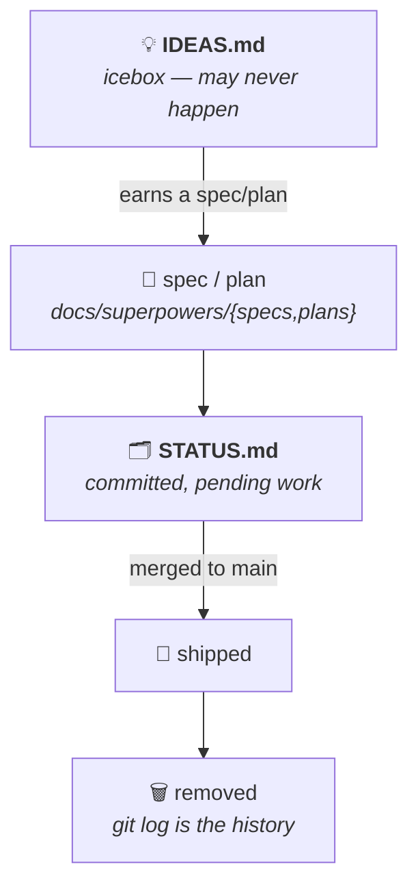

# Ideas — Icebox

> Speculative ideas and wishlist items — things worth writing down before they're
> forgotten, but **not yet committed to**. No spec, no plan, may never happen.
>
> This is the *upstream* of [`STATUS.md`](STATUS.md). When an idea earns a spec
> or plan, **move** it out of here into `STATUS.md` (with a link to its plan) —
> don't leave it in both places. This file only ever holds things that have *not*
> graduated. For the full document map, see [`README.md`](README.md).

An idea's lifecycle:

---

## Jarvis

### Generative-UI compositions (post-L1/L2 riffs)

Compositions of shipped systems with the panel surface, noted 2026-08-09 while
surveying what generative UI could become — each rides the roadmap
([architecture §19](architecture/19-ai-capability-roadmap.md)) rather than
adding to it: **narrator × panels** (an anomaly narration *offers* a chart
panel — the offers-never-executes persona clause already anticipates the
handshake); **sentinels × panels** (a standing watcher renders its own live
panel showing trigger proximity); **drive × panels × narrator** (a "morning
briefing" turn that rearranges the workspace, spawns overnight-movers panels
and narrates them — three shipped systems in one choreographed turn); and
**renderer-vocabulary growth** (depth ladder, correlation matrix, PnL
waterfall — each closed-vocab `PanelSpec` kind multiplies what every future
feature can express without ever granting the model arbitrary UI power).

### Generative-UI standards adapter (A2UI / MCP Apps)

Expose the Jarvis panel surface to external hosts through an emerging
agent-UI standard — a server-side `PanelSpec` ↔ standard-messages adapter, the
same boundary move as the `/mcp` endpoint. Assessed 2026-09-10 and deliberately
**not** adopted as the internal contract (pre-GA specs, unsettled standards
race, our domain vocabulary is stronger than the generic catalogs); evaluate
MCP Apps before A2UI if an interop round ever happens. Full comparison:
[research/2026-09-10-a2ui-genui-standards-landscape.md](research/2026-09-10-a2ui-genui-standards-landscape.md).

## Tooling & workflow

### Adopt a GitHub merge queue

**Decided 2026-07-26: not available to this repo** — GitHub merge queue needs an
organization-owned repository and this one is user-owned. Rule 3's manual
catch-up triage in the [`shipping-repo-changes`](../.claude/skills/shipping-repo-changes/SKILL.md)
skill is the permanent mechanism. Revisit only if the repo moves to an
organization; measurements and the full amendment live in the
[design spec](superpowers/specs/2026-07-26-catchup-triage-and-merge-queue-design.md).

### RN sibling `X.styles.ts` split

Move each component's `StyleSheet.create` block to a sibling `X.styles.ts`,
mirroring the web clients' `.module.css` co-location. Cosmetic symmetry; 69
files. Deliberately deferred 2026-09-01 (chose lint-gaps-only) — see
[`rn-styling.md`](rn-styling.md).

### RN styling library evaluation

Only worth revisiting if a real limitation of `StyleSheet.create` +
`useThemedStyles` appears (e.g. web+native single-source styling) — then
consider react-native-unistyles / react-strict-dom. Deferred 2026-09-01 — see
[`rn-styling.md`](rn-styling.md).

### Devtools `bind()` layer

A thin reactive-bindings layer over `InspectorStore` (the devtools analogue of
`react-bindings`), replacing the `useSyncExternalStore` seam and folding
`useTimeline`/`useNavigation` `useState` view state into store-backed selectors.
Considered 2026-09-01, deferred: real work for an 11-component UI already holding
≥95% coverage. Revisit if the inspector grows enough view state to make
prop-drilling or render-scope bugs recur.

### Split `CLAUDE.md` into a shared `AGENTS.md`

Only worth doing if a second coding agent (e.g. Codex) becomes a regular tool
here. Assessed 2026-10-03, deferred: nothing but Claude Code reads the repo's
instructions today.

Verified that day against the vendors' docs
([Claude Code](https://code.claude.com/docs/en/memory#agents-md),
[Codex](https://learn.chatgpt.com/docs/agent-configuration/agents-md)):

- **Claude Code** (v2.1.277+) reads `AGENTS.md` natively, but only when no
  `CLAUDE.md` / `CLAUDE.local.md` exists at or above the working directory.
  With both present it reads `CLAUDE.md` only, unless that file imports
  `@AGENTS.md`.
- **Codex** (checked against codex-cli 0.160.0) reads `AGENTS.override.md` then
  `AGENTS.md`, walking from the git root down to the cwd. It never reads
  `CLAUDE.md` unless `~/.codex/config.toml` sets
  `project_doc_fallback_filenames = ["CLAUDE.md"]`.
- **Codex caps** combined instructions at 32 KiB (`project_doc_max_bytes`), and
  `CLAUDE.md` was 45 KB, so the fallback alone would not load it whole.
- **Codex documents no `@import`**, so sharing only works one way: `CLAUDE.md`
  importing `AGENTS.md`.

The shape, if it happens: move the tool-neutral content (build commands,
package structure, dependency rules, test-fixture and naming doctrine) into
`AGENTS.md`, and keep `CLAUDE.md` as `@AGENTS.md` plus the Claude-only sections
(slash commands, `.claude/` authoring traps). That keeps the ~96 files
referencing `CLAUDE.md` valid, and works on Claude Code versions that cannot
read `AGENTS.md` directly.

What does not carry over: `.claude/` commands, skills, hooks and permissions
are Claude-only, so hook-enforced guardrails (e.g.
`split-outward-commands.py`) would not apply under Codex.

Zero-change trial: set the fallback plus `project_doc_max_bytes = 65536` in the
user's own Codex config — no repo edit needed.

### Replace `STATUS.md` and this file with a real backlog and board

`docs/STATUS.md` conflicts constantly and no human can read it. The user wants
this solved, just not yet. Assessed 2026-11-01; nothing has been adopted.

**The problem, measured that day:**

- `STATUS.md` is 103 KB across 74 bullets, averaging 1.3 KB each. Its longest
  single line is 18,261 characters.
- Replaying the 634 merges since 2026-09-01 with `git merge-tree`, 51
  conflicted and `STATUS.md` was in 21 of them, the most of any file
  (`CLAUDE.md` was next with 11).
- 118 of the 213 PRs merged since 2026-10-01 edited it. Git merges by line, so
  one shared file of very long lines collides easily. The cause is the
  workflow as much as the format.
- [`rn-open-items.md`](rn-open-items.md) (97 KB) may be a third backlog of the
  same shape. Check it before migrating.

**Options, in the order to try them:**

1. **[Backlog.md](https://github.com/MrLesk/Backlog.md).** One Markdown file
   per task in the repo, with a terminal board, a local web board, a CLI and an
   MCP server. MIT, TypeScript, 7.2k stars, v1.55.3 released 2026-10-23.
   Status stays in PR review. Its risk is sequential IDs, which parallel
   worktrees could duplicate, and open bug
   [#1146](https://github.com/MrLesk/Backlog.md/issues/1146) says duplicates
   make `task list` and `search` fail. Prefer the CLI to MCP:
   [#1034](https://github.com/MrLesk/Backlog.md/issues/1034) reports MCP
   writes landing in the wrong worktree, though the README now says MCP
   follows worktrees.
2. **Our own board, if Backlog.md fails that test.** One file per item under
   `docs/backlog/`, with YAML frontmatter (title, status, area, blocked-by,
   plan). A `scripts/backlog-board.mts` generator renders one static page,
   `publish-site.yml` publishes it (not yet checked that it fits), and a CI
   gate validates the frontmatter. A filename as the ID removes the collision
   risk. The board is read-only, so a status change is a PR. Estimated at a few
   hundred lines; the larger job is splitting the 74 bullets by hand or by
   agent.
3. **GitHub Issues + Projects.** Free, already enabled, with hosted boards, and
   `Closes #N` would replace the manual cleanup. It loses same-PR review,
   offline reading and `check:doc-links` coverage. Issue types are documented
   only for organizations, so use labels. `gh` needs the project scope for
   boards.

**Ruled out:**

- **[Beads](https://github.com/gastownhall/beads)** has plenty of human tools,
  but its source of truth is a gitignored Dolt database synced through
  `refs/dolt/data`, outside normal PR review. Its embedded default also allows
  only one writer at a time.
- **Linear** caps the free plan at about 250 issues per third-party sources;
  its own docs only imply that figure, and its pricing page would not load.

**A possible community contribution.** A new Beads viewer would be lost among
the [~60 listed](https://beads.gascity.com/community-tools), 20 of them marked
historical or stale. The gap worth testing is a hosted, read-only board for
Backlog.md that opens on a phone: its README shows only a local board and a
Markdown export, though this was not checked exhaustively. Propose it as an
issue first, because
[#1063](https://github.com/MrLesk/Backlog.md/issues/1063) reports that the
maintainers want one before a PR and closed an earlier proposal over scope. If
they decline, publish it as a companion tool. The same generator serves option
2 if written against its own format.

**The first step when this is picked up:** test Backlog.md in a throwaway repo.
Create tasks on two parallel worktrees with nothing pushed, merge both, and see
whether the IDs collide. This did not run on 2026-11-01 because the permission
classifier blocked the install. If it passes, trial Backlog.md on this file
first, then `STATUS.md`. Delete each old file as it moves, or leave a one-line
pointer, so there are never two sources of truth. Specs, plans, ADRs and
`CHANGELOG.md` stay as they are.

### Shrink the repository (screenshot history)

The GitHub repo is **1.96 GB** and nearly all of it is old PNG versions, not
code. Measured 2026-10-17 (on-disk, delta-compressed sizes from
`git rev-list --objects <ref> | git cat-file --batch-check='%(objecttype) %(objectsize:disk) %(rest)'`):

| History of | Size |
|---|---|
| `packages/ui-contract/goldens` (visual goldens) | 1,291 MB |
| `packages/client-react/tests/ui` — **path no longer exists** (goldens moved) | 419 MB |
| `packages/client-react-native/tests` (RN goldens) | 134 MB |
| all code, docs, lockfiles | ~50 MB |
| `gh-pages` branch (547 commits of published reports) | 266 MB |

The current tree is only ~360 MB of images, so ~1.5 GB is dead history. PNGs
are already compressed, so git cannot delta them: every regeneration stores
every changed golden whole. Two full sets are committed — `react/` (2,012
files, the CI x86 set) and `react-local/darwin-arm64/` (2,107 files) — so each
visual change is paid twice. Since August the goldens churn at ~2,600 PNG
writes a month (~80 KB each, so very roughly ~200 MB/month).

Options, cheapest first. Not urgent — GitHub's guidance is under 1 GB ideal,
under 5 GB strongly recommended — but the first three stop the growth:

1. **Partial clone** (no repo change): `git clone --filter=blob:none` fetches
   old blobs on demand, so a fresh clone costs about the current tree. CI
   already checks out shallow.
2. ~~Publish `gh-pages` as a single orphan commit~~ — **done 2026-10-24**:
   `publish-to-pages.mts` now force-pushes one parentless commit under a lease
   ([`docs/pages/README.md`](pages/README.md)). The old ~266 MB of `gh-pages`
   history stops being reachable; GitHub reclaims it on its own schedule.
3. **Cut golden churn.** **Decided 2026-10-24: keep committing
   `react-local/darwin-arm64`** for now, though git-ignoring it (or
   regenerating on demand) would roughly halve future golden growth — the
   largest saving still available. Revisit if repo size starts to hurt.
   **Done 2026-10-24:** `update-visual-goldens.yml`
   losslessly recompresses the goldens each run changed with a pinned `oxipng`
   (~26% smaller, pixel-identical on a 201-golden sample). Deliberately not a
   one-off pass over all existing goldens — that would add a full second copy
   of the set (~120 MB) to history to save on files that may never change
   again. Locally regenerated `react-local/` and RN goldens are not covered.
4. **Move goldens out of the repo** (separate repo/submodule or object
   storage keyed by a committed hash manifest) — stops screenshot growth
   entirely; a real project.
5. **One-time history rewrite** (`git filter-repo`): drop the dead
   `client-react/tests/ui` path and superseded golden versions — likely well
   under 1 GB. Costs: every SHA changes (`CHANGELOG.md`, `STATUS.md`, docs and
   the weekly tags cite them), every open PR and worktree breaks, and GitHub
   keeps old objects reachable via `refs/pull/*` until Support purges them.
   Only worth doing once, after 2–4, or it regrows.

**Not LFS.** Moving goldens to Git LFS looks like the fix but is worse here:
`visual.yml` needs the full ~330 MB set on every push to `main`, and LFS
downloads from Actions are metered against the account's LFS bandwidth quota,
while a plain shallow checkout is free; LFS storage also keeps every version;
and any checkout without `lfs: true` gets pointer files, which fail the pixel
comparisons with misleading errors. LFS stays scoped to rarely-changing design
media and decks (`.gitattributes`).
