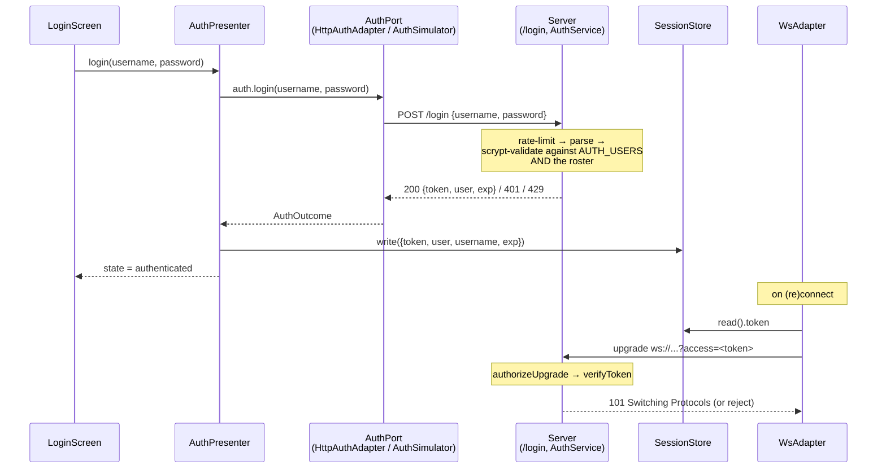
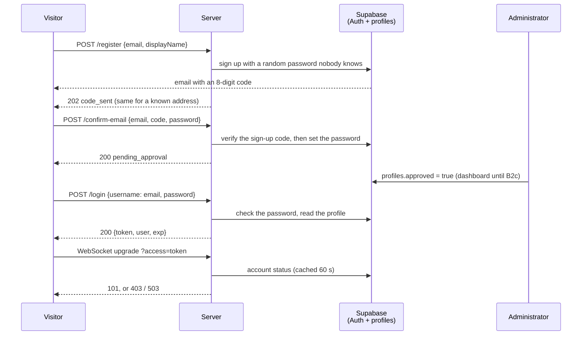
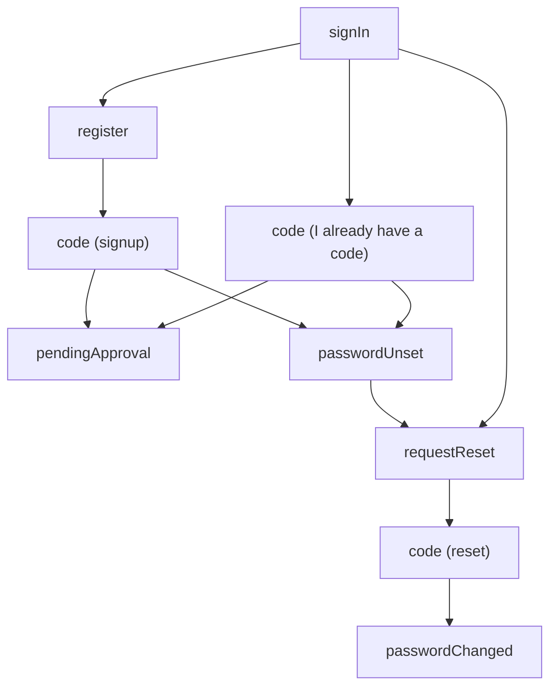

# Authentication

Genuine per-user, server-side login for both clients. There is no shared
secret anywhere in this system: each of the four roster operators signs in
with their own username and password, and the deployed web (`@rtc/client-react`)
and mobile (`@rtc/client-react-native`) clients both authenticate against the
same Fly server (with one deliberate exception since the hybrid, §6: a login
matching the committed demo roster is verified in the browser and runs the
in-browser simulators, so it never reaches the server). This replaced the old model — a single shared `SITE_PASSWORD`
wall in front of the whole app plus a static `VITE_WS_TOKEN` gating the
WebSocket — which no longer exists anywhere in this repo.

## 1. Overview

- **No shared secret.** The server's `AUTH_USERS` roster (a Fly secret,
  `"user:pass,user2:pass2"`) is the only source of real credentials. Signing
  in exchanges a username/password for a short-lived, per-user session token;
  nothing is gated by a single app-wide password anymore.
- **Server-issued, stateless tokens.** `AuthService`
  (`packages/server/src/auth/AuthService.ts`) validates credentials with
  `scrypt` + `timingSafeEqual` and, on success, signs an HMAC token
  (`packages/server/src/auth/token.ts`) carrying the username and an
  expiry — no server-side session table to manage.
- **Same flow, two transports.** In "WS-real" mode (a real server configured)
  both clients call the identical `POST /login` HTTP endpoint via
  `HttpAuthAdapter` (`packages/client-adapters/src/adapters/HttpAuthAdapter.ts`).
  In simulator mode (no server configured) each client instead uses the
  in-process `AuthSimulator` (`packages/domain/src/simulators/AuthSimulator.ts`),
  which validates against the same public roster plus locally-supplied dev
  credentials — no network call, no real security boundary.
- **Public roster, private passwords.** The four operator identities
  (`packages/domain/src/auth/roster.ts`) are checked into the repo — they are
  just display data (name, initials, role, desk, clearance). Passwords are
  never checked in anywhere; see [§4](#4-configuring-passwords--per-platform).
- **Registered accounts (since B2a).** Besides the roster, the server signs in
  registered accounts — an email address and a password checked against its
  own account store (Supabase in production), after the email is confirmed
  and an administrator has approved the account. `/login` sends any
  identifier containing `@` that way. See
  [§7](#7-registered-accounts-b2a).

## 2. How it works end to end



1. **`LoginScreen` → `useAuth().login(username, password)`.** Both clients'
   `LoginScreen` (`packages/client-react/src/ui/shell/auth/LoginScreen.tsx`,
   `packages/client-react-native/src/ui/shell/auth/LoginScreen.tsx`) are dumb
   forms: typed credentials live only in local component state, are never
   logged, and are handed straight to `useAuth().login` from the `useViewModel()`
   seam. The two web clients also render a **demo-accounts hint** under the
   form (`DemoAccountsHint`): one click-to-fill row per account the page
   verifies in the browser, plus the password when every account shares it.
   The list comes from `readDemoAccounts()` in `@rtc/web-boot`'s
   `buildBrowserPorts.ts` (`startWebClient` calls it once per page and hands the list to each client's `AppRoot`) through `useDemoAccounts()` — the simulator's
   roster with no server URL, the `VITE_DEMO_AUTH` roster on a hybrid build,
   and nothing on a plain live build, where every credential belongs to the
   server. Picking a row fills the fields and moves keyboard focus to AUTHENTICATE;
   it does not sign in.
2. **`AuthGate` renders `LoginScreen` until authenticated.** `AuthGate`
   (`packages/client-react/src/ui/shell/auth/AuthGate.tsx`,
   `packages/client-react-native/src/ui/shell/auth/AuthGate.tsx`) reads
   `useAuth().state.status`; anything other than `"authenticated"` (i.e.
   `"unauthenticated"` or `"authenticating"`) renders `LoginScreen` instead of
   the app's `children`.
3. **`AuthPresenter.login`** (`packages/client-core-rxjs/src/presenters/AuthPresenter.ts:73-84`)
   flips state to `"authenticating"` and calls the injected `AuthPort`.
4. **The `AuthPort`** is one of:
   - `HttpAuthAdapter` (`packages/client-adapters/src/adapters/HttpAuthAdapter.ts`) —
     `POST {httpBaseUrl}/login` with `{ username, password }`, used whenever a
     real server URL is configured. `wsUrlToHttpBase` derives the HTTP base
     from the WS URL by swapping only the scheme (`ws://`→`http://`,
     `wss://`→`https://`).
   - `AuthSimulator` (`packages/domain/src/simulators/AuthSimulator.ts`) —
     in-process, used in simulator mode. Validates the username against the
     public `ROSTER` and the password against an injected `DevCredentials` map;
     issues a cosmetic `sim.<username>.<id>` token (there is no real WS to gate
     in simulator mode).
5. **On the server, `authenticateLoginRequest`** (`packages/server/src/http/loginHandler.ts`)
   runs, in order: **ban check** (`BanList.bannedUntil`,
   `packages/server/src/auth/banList.ts` — a banned IP gets `429
   {"error":"banned"}` with `Retry-After` before anything else is read) →
   **rate-limit** the caller's IP (`RateLimiter.hit`, 10 requests/60s, table
   evicts expired windows and is bounded, `packages/server/src/auth/rateLimit.ts`;
   a `429` here is a ban strike) → **parse** the JSON body (`isLoginRequestDto`;
   the body itself was capped at 4 KiB by bytes received before this ran —
   `413` past it) → **`AuthService.login`**
   (`packages/server/src/auth/AuthService.ts`), which **asynchronously**
   scrypt-hashes the supplied password (off the event loop; an unknown username
   hashes against a dummy salt so it costs the same time) against the salted
   digest built from `AUTH_USERS` at startup (`timingSafeEqual`, so no
   early-exit timing leak; a `401` is a ban strike) **and** requires
   the username to resolve via `findRosterUser` — a valid password for a
   username missing from the roster still fails login. On success it signs a
   token via `signToken(username, secret, ttlMs, now)`
   (`packages/server/src/auth/token.ts:16-25`) — an HMAC-SHA256 over a
   base64url-encoded `{ u: username, exp: now + ttlMs }` payload, TTL default
   **8 hours** (`AUTH_TTL_MS` in `packages/server/src/index.ts`).
6. **Fail-fast on misconfiguration.** `AuthService`'s constructor throws
   `"AUTH_SECRET must be set when AUTH_USERS is configured"`
   (`AuthService.ts:45-47`) if `AUTH_USERS` has entries but `AUTH_SECRET` is
   empty — a deploy can never silently serve unsigned/unverifiable tokens.
7. **The client stores the session.** On a `{ ok: true, token, user }`
   outcome, `AuthPresenter.commitLoginOutcome` writes
   `{ token, user, username, exp }` to the injected
   `SessionStore` (`packages/core-api/src/adapters.ts`) —
   `exp` is the expiry the `AuthPort` reported (the server's real token expiry,
   or the simulator's `now() + ttlMs`), persisted verbatim rather than
   recomputed from a client-side TTL — and flips state to `"authenticated"`.
8. **The WebSocket connects with the token.** `WsAdapter` reads
   `sessionStore.read()?.token` fresh on every (re)connect and appends it as
   `?access=<token>` to the WS URL (both `buildBrowserPorts.ts` and
   `buildNativePorts.ts` wire this identically). The server's `verifyClient`
   hook, `authorizeUpgrade` (`packages/server/src/http/loginHandler.ts`),
   rejects the upgrade outright on a missing URL, a missing `access` param, or
   a token that fails `AuthService.verifyToken` (bad signature, wrong secret,
   or expired) — there is no open-when-empty fallback.
9. **Resume on boot.** `AuthPresenter`'s constructor calls `resume()`
   (`AuthPresenter.ts:55-70`): if the `SessionStore` holds an entry whose `exp`
   is still in the future, the presenter starts already `"authenticated"` with
   that user; otherwise it clears the stale entry and starts
   `"unauthenticated"`. (The web `LocalStorageSessionStore` persists across
   reloads; the RN `InMemorySessionStore` does not survive an app relaunch, so
   mobile always shows `LoginScreen` on cold start — see
   [§4](#4-configuring-passwords--per-platform).)
10. **Lock and re-auth.** `AuthPresenter.lock()` sets `locked: true` on an
    authenticated session (a no-op otherwise); `unlock(password)` re-runs the
    exact same `AuthPort.login` flow for the *current* username and, on
    success, refreshes the stored session and clears the lock — this is a
    genuine password re-check against the server/simulator, not a cosmetic
    toggle. `LockScreen` (`packages/client-react/src/ui/shell/lock/LockScreen.tsx`)
    renders `null` unless `state.locked`, and its `AUTHENTICATE ▸` button
    submits a form that calls `unlock(password)`.
11. **Logout.** `AuthPresenter.logout()` clears the `SessionStore` and returns
    to `UNAUTHENTICATED_STATE`, dropping back to `LoginScreen` via `AuthGate`.
    The web `AccountMenu` (`packages/client-react/src/ui/shell/chrome/AccountMenu.tsx`)
    exposes both **⏻ LOCK SESSION** (`lock()`) and **⏻ SIGN OUT** (`logout()`)
    rows, alongside the account's identity (name, email, trader id, desk,
    clearance) read straight from `useAuth().state.user`.

## 3. The four roster users → the profile dropdown

The public roster (`packages/domain/src/auth/roster.ts`) drives the identity
shown once signed in — the account avatar/initials, the `LockScreen` operator
card, and the web `AccountMenu` panel all read this data verbatim from
`state.user`:

| Username | Name | Initials | Role | Trader ID | Email | Desk | Clearance |
|---|---|---|---|---|---|---|---|
| `astark` | Anthony Stark | AS | Senior FX Trader | TRD-0042 | a.stark@reactivetrader.io | G10 Spot · London | LEVEL 4 · FULL |
| `nromanoff` | Natasha Romanoff | NR | Credit Trader | TRD-0071 | n.romanoff@reactivetrader.io | Credit · London | LEVEL 3 · DESK |
| `tchalla` | T'Challa | TC | Head of Equities | TRD-0007 | t.challa@reactivetrader.io | Equities · New York | LEVEL 5 · FULL |
| `demo` | Demo Operator | DO | Read-Only Guest | TRD-0000 | demo@reactivetrader.io | Demo · Cloud | LEVEL 1 · VIEW |

Notes:

- **The username is the roster key** that drives the displayed identity —
  `findRosterUser(username)` (`roster.ts:61-65`) looks the entry up by exact
  match on `entry.username`.
- **The password is validation-only and never displayed.** It lives entirely
  in `AUTH_USERS` (server) or a dev-credentials map (simulator) — never in
  `ROSTER`, never rendered anywhere in the UI, never logged (`HttpAuthAdapter`,
  `AuthSimulator`, and `AuthPresenter` all say so in their own doc comments).
- **A username not in the roster always fails login**, even with a password
  that would otherwise match — both `AuthService.login`
  (`AuthService.ts:81-85`) and `AuthSimulator.login` (`AuthSimulator.ts:19-25`)
  require a `findRosterUser` hit in addition to the credential check.
- **`role` and `clearance` are display-only.** There is no per-role
  authorization anywhere in this Phase-1 implementation — every signed-in user
  sees and can do the same things regardless of their `role`/`clearance`
  string; those fields exist purely for the HUD's identity chrome.
- **Adding a user** requires two separate edits, in two separate places, by
  design: (1) add a `RosterEntry` to `ROSTER` in `roster.ts` — this is code,
  committed to the repo, since profiles are public — and (2) add a matching
  credential to `AUTH_USERS` (deployed / local full-stack) and/or a
  dev-credentials map (simulator). For this **demo app** the local credentials
  are committed (`.env.development` + the `dev:*` scripts, see §5); the deployed
  password is a Fly `AUTH_USERS` secret. A roster entry with no credential can
  never log in; a credential for a username with no roster entry also can never
  log in.

## 4. Configuring passwords — per platform

Credentials are configured independently per platform. **Nothing in this repo
holds a real deployed password** — every checked-in file uses a placeholder.

### Fly (`@rtc/server`) — the source of truth for deployed credentials

The Fly-hosted server is the only place real credentials exist, and they are
set **by hand** as Fly secrets (never through the deploy workflow, which only
has a code-deploy token):

```bash
fly secrets set AUTH_SECRET="$(openssl rand -hex 32)" -a rtc-clone-server
fly secrets set AUTH_USERS="astark:<pw>,demo:<pw>" -a rtc-clone-server
# optional — defaults to 8h:
fly secrets set AUTH_TTL_MS="28800000" -a rtc-clone-server
```

Only usernames present in `ROSTER` can ever log in, regardless of what's in
`AUTH_USERS` (§3) — so a rotation changes a persona's *password*, never its
name, and `AUTH_USERS` may list fewer personas than the roster, or none
([`security.md` §2.2](security.md#22-server-roster-personas--two-halves-one-of-them-fixed)). See [`docs/DEPLOY.md`](DEPLOY.md#1-flyio-server) for the
full one-time setup.

### Vercel (web client host) — holds no passwords

The old `SITE_PASSWORD` edge wall and `VITE_WS_TOKEN` are gone entirely.
Vercel needs exactly one auth-adjacent variable:

```
VITE_SERVER_URL = wss://rtc-clone-server.fly.dev
```

so the deployed client knows where to `POST /login` and open its WebSocket.
The second auth-adjacent value the deployed client carries, the demo roster
(`VITE_DEMO_AUTH`), is not a Vercel variable at all: it is baked from the
committed `.env.production`. Together they make the deployed build **hybrid**
(§6): credentials matching the demo roster are verified in the browser and
never reach any server; every other login authenticates live against the Fly
server's own `AUTH_USERS`. Vercel itself never sees or stores a credential.

### React Native (`@rtc/client-react-native`)

- **Live mode** (a real server URL configured) bakes **no credential** into
  the app at all: `buildNativePorts.ts` wires `HttpAuthAdapter` against the
  same deployed server, so signing in on-device means signing in with a real
  `AUTH_USERS` credential — ask the team for one.
- **Simulator mode** (the in-app `Sim` toggle, or no server configured) uses
  `EXPO_PUBLIC_DEV_AUTH` — a JSON `username -> password` object, parsed by
  `nativeAuthConfig.ts`'s `parseDevAuth` into `DEV_CREDENTIALS`. If that
  variable is unset, empty, or malformed, it falls back to a built-in map of
  all four roster usernames at the shared password `"mcdc2026"`
  (`FALLBACK_DEV_CREDENTIALS`, `nativeAuthConfig.ts:19-24`) — so the offline
  simulator always has a working login with zero env configured. This never
  reaches a deployed server; it is simulator/local-only.

`EXPO_PUBLIC_*` variables are inlined into the JS bundle at Metro start, not
hot-reloaded — after editing `.env` you must restart Metro
(`pnpm dev:ios` or `pnpm dev:android`), not just reload in-app.

### Local web dev (`pnpm dev`, simulator mode)

`packages/client-react/.env.development` is **committed** with the demo roster,
so a fresh clone signs in out of the box — no setup. Vite loads it in dev only
(never in a production build). Sign in as any roster user — `astark`,
`nromanoff`, `tchalla`, or `demo` — with password `mcdc2026`.

Without `VITE_SERVER_URL` set, `buildBrowserPorts.ts` (in `@rtc/web-boot`) takes the simulator branch
and parses `VITE_DEV_AUTH` via its own `parseDevAuth`, tolerant of a
missing/malformed value (degrading to "no dev logins work" rather than a boot
crash) — unlike the RN client it has no built-in fallback roster in code, so
the committed `.env.development` is what makes web logins work locally. To use
your own credentials instead, override `VITE_DEV_AUTH` in an untracked
`.env.local` (Vite gives `.local` files precedence).

Full-stack local dev (`dev:react:fs` / `dev:ws`) is WS-real, so it ignores
`VITE_DEV_AUTH` and authenticates against the **server's** `AUTH_USERS` instead
— a different format, `"user:pass,..."`, plus `AUTH_SECRET`. The `dev:ws` /
`dev:*:fs` scripts bake in the same demo roster, so full-stack also works out of
the box.

`@rtc/client-solid` (`pnpm dev:solid`) follows the identical mechanism: its own
committed `packages/client-solid/.env.development` carries the same
`VITE_DEV_AUTH` value, and it reads it through the same `buildBrowserPorts.ts`
and `parseDevAuth` helper as `client-react` (one copy, in `@rtc/web-boot`) —
the two web clients are at full parity here, not just visually and
behaviourally.

## 5. What's committed vs. what stays secret

This is a **demo app**, so the demo *login* credentials are intentionally
committed — the roster password (`mcdc2026` for `astark` / `nromanoff` /
`tchalla` / `demo`) lives in `packages/client-react/.env.development` and
`packages/client-solid/.env.development` (simulator, both web clients), in
each web client's committed `.env.production` (`VITE_DEMO_AUTH`, the same JSON
format — the roster a **production** build inlines so the deployed hybrid
build can verify demo logins in the browser, §6), and in the `dev:ws` /
`dev:*:fs` scripts' `AUTH_USERS` (full-stack). They're throwaway and
rotatable: change the password in those places (and the Fly `AUTH_USERS`
secret) if it ever matters.

The **dev registered accounts** are committed too, for the same reason: the
in-memory account directory's four seeded `@rtc.test` addresses, their
password `Mcdc2026!desk` and its fixed confirmation code `00000000`
(`packages/server/src/accounts/devAccounts.ts` and
`InMemoryAccountDirectory.ts`, [§7.7](#77-dev-accounts)). They can never work on
a deployed server: the server refuses to start with the in-memory directory
when `FLY_APP_NAME` or `RTC_DEPLOYED` is set.

What still stays **out of version control** is the thing that actually protects
the deployed app: the server's **`AUTH_SECRET`** — the HMAC key that signs and
verifies session tokens. It's a Fly secret set by hand (dev uses a throwaway
`dev-local-secret-public-by-design-never-deploy` in the scripts). Public demo logins only let someone sign in
as the roster's `Read-Only Guest`; without `AUTH_SECRET` nobody can forge a
token. With accounts enabled it also signs administrator sessions, so the
server then requires it to be at least 32 characters. The account store's key,
**`SUPABASE_SECRET_KEY`**, is a Fly secret as well: it bypasses Supabase's
row-level security, lives only on the server, and is never in a client, a
client build or `@rtc/shared` / `@rtc/domain`. The `.env.example` templates still ship placeholder values, and an
untracked `.env.local` overrides the committed demo creds. See
[`docs/env-files.md`](env-files.md) for the full inventory of every `.env*`
file, and [`docs/DEPLOY.md`](DEPLOY.md) for the deploy-time setup walkthrough.

## 6. Hybrid data source (one deployment, two modes)

Since 2026-10-01 the deployed web build is **hybrid**: one deployment, and the
**login decides the data source** (hardening spec §8, linked below).

- Credentials that match the committed **demo roster** are verified in the
  browser, and the app runs on the in-browser simulators with the scripted
  Jarvis. Nothing is sent to any server.
- Any other credentials are posted to the server's `/login`. On success the app
  runs on the real WebSocket transport with real, metered AI.

The criterion is **credential match** (username *and* password equal a demo
entry), not username membership. A demo username with a non-demo password is a
server login. That keeps every existing full-stack dev and e2e flow working,
whose server roster is `demo:demo`, while the bundle's demo entry is
`demo:mcdc2026`.

### 6.1 Composition

The client composes its ports once per page load, before the login screen
(`main.tsx` → `startWebClient` → `buildBrowserPorts()`). The hybrid therefore chooses the port set
**at load**, from a stored choice, exactly as the load-time core switch does
(ADR-006 Decision 6):

| `VITE_SERVER_URL` | `VITE_DEMO_AUTH` | Composed | Behaviour |
|---|---|---|---|
| empty | any | **sim** | Today's simulator mode. The roster is `VITE_DEV_AUTH` ∪ `VITE_DEMO_AUTH`. This is also the Track A fallback build. |
| set | empty | **live** | Today's WS-real mode, byte for byte. Every `dev:*:fs`, `dev:*:ws:*` and e2e flow lands here, because `.env.development` carries no `VITE_DEMO_AUTH`. |
| set | set | **hybrid** | The stored choice (`localStorage["rtc.dataSource"]`, `"sim"` or `"live"`) decides. Absent choice: `live` when a stored session exists (a pre-hybrid live session), else `sim`. |

`VITE_DEMO_AUTH` is committed in each web client's `.env.production`, so only a
production build with a server URL is hybrid. The deploy workflow asserts the
roster was inlined, next to its existing server-URL guard.

In a hybrid page the `auth` port is a **routing port** (`createRoutingAuthPort`
in `@rtc/client-adapters`): it tries the demo roster first (synchronously, in the
browser), then the server. The demo roster never leaves the browser because the
server attempt only runs after the local match has failed.

### 6.2 Reload dynamics

A reload happens **only on a mode change**, triggered by a successful login,
never by boot.

1. **Boot.** No stored choice, so the client composes **sim** and shows the
   login screen.
2. **Demo login.** Local match succeeds; the composed mode already matches.
   The routing port writes the choice (`sim`) and emits the outcome. No
   reload. The app renders at once.
3. **Registered login.** Local match fails; `/login` succeeds. The target is
   `live`, the page is composed `sim`, so the routing port **writes the
   session and the choice, calls `relaunch()` (a `location.reload()`), and
   never emits** (a pending observable, not a completed one: the async and
   Effect cores treat "completed without a value" as an error). The login
   screen stays in its "authenticating" state for the few milliseconds until
   the page unloads.
4. **After the reload.** The client reads the stored choice, composes
   **live**, and `AuthPresenter.resume()` restores the session from storage,
   so no login screen is shown; the WebSocket opens with the stored token. The
   boot splash replays on this load (D8).
5. **Next visit on that device.** Stored choice is `live`, so boot composes
   live directly. No reload.
6. **Logout.** Clears the session; the choice stays. The next login decides
   afresh, so a demo login on a live-composed page relaunches back into sim
   (step 3 mirrored).
7. **Unlock (lock screen).** Re-authenticates with the same username. Same
   credentials → same target → no reload.

Two consequences to know about:

- **The cinematic login wait is cut short on a mode change.** The wait
  (`withLoginDelay`) wraps the routing port, so the relaunch fires when the
  outcome is known, before the delay would have delivered it. A mode change
  happens once per device, and the reload plays the splash, which takes the
  wait's place.
- **Why not swap ports without a reload.** Presenters subscribe to their ports
  at construction, and the core contract suites assert construction-time port
  counts (`portDiscipline`). Swapping implementations under running presenters
  would break the equivalence guarantee across all three cores. A reload keeps
  the one composition root honest.

The console line `[data] composed <sim|live> from <reason>` says which rule
won, mirroring `[core] booted …`.

### 6.3 Where the pieces live

- `resolveDataSource` and `createRoutingAuthPort` — `@rtc/client-adapters`
  (framework-free; `location.reload()` is the default `relaunch`, which
  `buildBrowserPorts` takes as an option so a test can inject its own).
- The composition, the `VITE_DEMO_AUTH` parsing and the `rtc.dataSource`
  store — `packages/web-boot/src/buildBrowserPorts.ts`, one copy shared by
  `client-react` and `client-solid`.
- The committed roster for production builds — `packages/client-react/.env.production`
  and `packages/client-solid/.env.production` (inventory in
  [`docs/env-files.md`](env-files.md)); the deploy-time guard that the roster
  was inlined — [`docs/DEPLOY.md`](DEPLOY.md).
- The full design, invariants and what is deliberately not in this slice —
  [hardening spec §8](superpowers/specs/2026-09-27-public-launch-hardening-design.md#8-hybrid-data-source-revision-2026-09-29-built-2026-10-01).

## 7. Registered accounts (B2a)

A visitor registers with an email address and a display name, proves the
mailbox with an 8-digit emailed code — and sets a password in that same
request — and then waits for an administrator to approve the account. Once
approved, the account signs in through the same `POST /login` as the roster
and gets the same kind of session token. The design, with its dated
amendments, is the
[B2 spec](superpowers/specs/2026-10-04-b2-user-management-design.md); the
privacy notice is [`privacy.md`](privacy.md).

B2a is the server half; [§7.9](#79-the-client-flows-b2b) is the client half
(B2b): the login screens of both web clients register, confirm and reset. The
same calls can still be made with `curl`
([`DEPLOY.md` §4](DEPLOY.md#4-supabase-account-store) has them). Signing in
works from the sign-in form because the hybrid client sends every non-demo
credential to `/login`: type the email address as the username. Each of the
three `403` refusals (`unconfirmed`, `pending`, `blocked`) has its own message.

Only `@rtc/server` knows the account store exists. No Supabase URL, key or
SDK is in a client, in `@rtc/shared` or in `@rtc/domain`, and Supabase's own
session tokens are used inside one server request and then logged out
(`POST /auth/v1/logout?scope=local`; a failed logout is ignored).

### 7.1 Three modes

| Environment | Account store | `GET /health/accounts` → `directory` |
|---|---|---|
| `SUPABASE_URL` + `SUPABASE_SECRET_KEY` | Supabase (Auth + the `profiles` table), production | `up` or `down` |
| `RTC_DEV_ACCOUNTS=1` | in-memory, four seeded accounts ([§7.7](#77-dev-accounts)), dev and the full-stack smoke | `in-memory` |
| neither | **disabled**: every account call is unavailable, so a registered login answers `503 unavailable`; the roster is untouched | `disabled` |

The dev directory is never a default: an unset `SUPABASE_URL` means
`disabled`, not in-memory, and only the exact value `1` turns it on.
`/health/accounts` is a token-free `GET` answering
`{"ok":true,"directory":"…"}`; only the Supabase mode reads the store, at
most once per `ACCOUNTS_HEALTH_CACHE_MS` (60 s). The startup log prints the
mode as `Accounts: <supabase|in-memory|disabled>`.

**The server will not start** (it throws before listening, and never echoes
a value) if:

- `RTC_DEV_ACCOUNTS=1` and `FLY_APP_NAME` or `RTC_DEPLOYED` is set (non-empty)
  — Fly sets `FLY_APP_NAME` on every machine, and the server's container
  image (`packages/server/Dockerfile`) sets `RTC_DEPLOYED=1` whatever host
  runs it, so the dev directory can never run deployed;
- `RTC_DEV_ACCOUNTS=1` and `SUPABASE_URL` are both set;
- `SUPABASE_SECRET_KEY` is set without `SUPABASE_URL`, or `SUPABASE_URL`
  without `SUPABASE_SECRET_KEY`;
- `SUPABASE_URL` does not start with `https://`;
- either account mode is on and `AUTH_SECRET` is empty or, trimmed, shorter
  than `AUTH_SECRET_MIN_LENGTH` (32) characters;
- `REGISTRATION_OPEN` is set to anything but `true` or `false` (unset means
  open);
- an `AUTH_USERS` username contains `@`, or `AUTH_USERS` has entries and
  `AUTH_SECRET` is empty (the latter unchanged since before B2).

### 7.2 The flow



**Why the password arrives with the code.** Supabase Auth does not update an
unconfirmed user when the same address signs up again — it re-sends the
code — so a password chosen at registration could be an attacker's, waiting
for the real owner to confirm the address (account pre-hijacking). A
sign-up therefore stores a random password nobody ever sees, and only the
request that proves the mailbox sets the real one. The password rule is
checked before the store is asked, so a weak password does not spend the
code. If the store accepts the code but refuses the password (a stricter
policy or leaked-password protection in the project), the answer is
`password_unset`: the address is confirmed, and the user sets a password
through the reset flow.

The Supabase adapter verifies a confirmation code with OTP type `signup`,
which accepts only the sign-up code; type `email` would also accept a
recovery code and make `/confirm-email` a second reset path. A reset uses
type `recovery`.

**Known residual:** an address someone else registered earlier and never
confirmed keeps that first display name when its owner registers and
confirms. It is not a credential; the administrator sees it beside the email
at approval, and a rename comes with the B2c Users panel.

### 7.3 Endpoints

All six are `POST` with a JSON body, capped at
`ACCOUNT_MAX_BODY_BYTES` / `LOGIN_MAX_BODY_BYTES` (4 KiB, bytes received),
and checked in this order: the origin and content-type rules (below), the
ban list, the endpoint's own per-IP limit, the JSON and its shape. A success body is `{"status": …}`; a failure body is
`{"error": …, "rule"?: …}` (`AccountFlowResponseDto` / `AccountErrorDto` in
`packages/shared/src/protocol/auth.ts`).

**Browsers.** The router (`http/postRouter.ts`) accepts a browser only from
an origin listed in `RTC_ALLOWED_ORIGINS` (comma-separated
`scheme://host[:port]`; unset on a dev machine means `http://localhost` and
`http://127.0.0.1` on any port; unset on a deployed server the process does
not start). A `POST` whose `Origin` is `null` or not allowed is answered
`403 origin_not_allowed`, and one whose `Content-Type` is not
`application/json` is answered `415 unsupported_media_type` (a parameter
such as `; charset=utf-8` is fine, and the content-type rule is what stops a
cross-site form post, which needs no preflight). Both are decided before
the body is read and neither is a ban strike: the sender is a victim's
browser. A request with **no** `Origin` header is not a browser's and
passes: the mobile client, `curl`, the probe. The preflight (`OPTIONS`)
answers `204` for an allowed origin and `403` otherwise, with
`Access-Control-Max-Age` of `CORS_MAX_AGE_SECONDS`; every response to an
allowed origin carries `Access-Control-Allow-Origin: <that origin>` and
`Vary: Origin`, and a foreign page reads none. The GET routes (`/health`,
`/health/accounts`) and `/mcp` keep `*`. Why: a foreign page could
otherwise make its visitors' browsers register, resend and guess codes from
their own addresses, inside every per-IP budget
([hardening spec §3.1](superpowers/specs/2026-10-13-b2a-hardening-design.md)).

**The caller's IP** is the platform header (`Fly-Client-IP`, or
`RTC_TRUSTED_IP_HEADER`), else the socket address, collapsed by
`collapseToNetworkKey` (`packages/server/src/http/clientIp.ts`) before any
bound reads it: an IPv4 address is itself, an IPv4-mapped IPv6 address
(`::ffff:a.b.c.d`) is the IPv4 address, and any other IPv6 address is its
/64 network, spelled as its first four hextets plus `::`
(`2001:db8:1:2:aaaa:bbbb:cccc:dddd` → `2001:db8:1:2::`). Each per-IP rate
limiter also charges an IPv6 caller's /48 (`widerNetworkKeyOf`) against a
budget four times as large, so a tunnel-broker /48 holding 65,536 /64s
cannot multiply every budget. One subscriber is
routed a whole /64, so keying on the full address would give anyone
unlimited keys. Every per-IP bound — the rate limiters, the ban list, the
connection caps — uses that key. The /48 tier applies only to the per-IP
rate limiters of the account routes and `/login`; the ban list and the
connection caps stay on the /64 key alone. The /64 key is also what the
Supabase adapter forwards as `Sb-Forwarded-For`, so Supabase buckets a /64
the same way.

| Endpoint | Body | Success | Specific failures |
|---|---|---|---|
| `/register` | `email`, `displayName` | `202 {status:"code_sent"}`, also for an address that already has an account | `400 invalid_request` with `rule` `email` or `display-name`; `403 registration_closed` (switch off, or the daily cap reached); `429 rate_limited` (the address's send budget; no strike); `503 unavailable` (also the hourly sign-up fuse) |
| `/resend-code` | `email` | `202 code_sent` for any well-formed address | `400 invalid_request` (`rule: "email"`); `429 rate_limited` (the address's send budget; no strike); `503` |
| `/confirm-email` | `email`, `code`, `password` | `200 {status:"pending_approval"}`, or `200 {status:"password_unset"}` | `400 invalid_request` with the failed password rule (the code is not spent); `400 invalid_code` (wrong, expired, or not eight digits; a ban strike); `429 rate_limited` (per-IP, or the address's code budget); `503` |
| `/login` | `username`, `password` | `200 {token, user, exp}` | `401 invalid_credentials` (a ban strike); `403 unconfirmed`, `403 pending_approval`, `403 blocked`; `503 unavailable` |
| `/request-reset` | `email` | `202 code_sent` for any well-formed address | `400 invalid_request` (`rule: "email"`); `429 rate_limited` (the address's send budget; no strike); `503` |
| `/reset-password` | `email`, `code`, `password` | `200 {status:"password_changed"}` | `400 invalid_request` with the failed password rule, or `rule: "password"` when Supabase refuses one the rule allowed; `400 invalid_code` (a ban strike); `429 rate_limited`; `503` |

A password refusal means different things at the two code endpoints. At
`/confirm-email` a password rule never spends the code: the rule is checked
before the store is asked, and a password the store refuses afterwards
answers `200 password_unset` instead. At `/reset-password`, `rule:
"password"` comes from the store **after** it accepted the code, so that
code is spent and the user must request a new one; the other rules are
checked before the store is asked and spend nothing. Both endpoints check
the address and the code's shape first (`invalid_code`), then the
password rule.

Every endpoint can also answer `403 origin_not_allowed`,
`415 unsupported_media_type`, `400 malformed_json`, `400 invalid_request`
without a `rule` (wrong shape), `413 body_too_large`, `429 banned` with
`Retry-After`, `429 rate_limited` (its per-IP limit; a ban strike) and
`500 internal_error`.

`/register`, `/resend-code` and `/request-reset` answer the same way whether
or not the address has an account, and the Supabase adapter reads every
refusal of a resend or a reset request — a per-address limit, say — as
"sent", so none of them reveals who is registered. They also answer
**before the mail is sent**: `/register` starts the sign-up without
awaiting it, and `/resend-code` and `/request-reset` look the address up
first (`findByEmail`) and start the send, again without awaiting it, only
where it will land (an unconfirmed account for a resend; a pending or
active one for a reset). A send whose outcome is anything but `sent` is one
log line with the route and the outcome word, never the address, so the
answer's timing says nothing about the address. A failed account login is
held to `LOGIN_FAILURE_FLOOR_MS` from the start of the handler, so an
unknown address and a wrong password take the same time; a success and a
roster login are not held.

**How the store's failures read.** Every store call is bounded by
`ACCOUNT_DIRECTORY_TIMEOUT_MS`. A timeout, a network failure or any 5xx
(Supabase answers 540 for a paused project) is `503 unavailable`. So is an
HTTP 401, or a 403 without an `error_code`: that is Supabase's gateway
refusing **our** key (rotated, revoked or mistyped), which says nothing
about the user and must not read as a wrong password or a bad code — those
are ban strikes. A sign-up Supabase throttles (`over_email_send_rate_limit`)
reads as `202 code_sent`, because that is also its answer for an address
that already has an account — but no email goes out. With Supabase's
built-in email sender, which allows a couple of emails an hour, a busy hour
therefore loses sign-ups silently; that is why a custom SMTP sender is
required before registration is opened
([`DEPLOY.md` §4](DEPLOY.md#4-supabase-account-store)). The user's way out,
once the limit has passed, is to register again (which re-sends the code for
an address that already has an account) or to call `/resend-code`.

The password rule is `@rtc/domain`'s `PASSWORD_RULES`: at least 12
characters, at most 72 bytes (bcrypt's limit), an uppercase letter, a
lowercase letter, a digit and a special character; the `rule` values are
`min-length`, `max-length`, `uppercase`, `lowercase`, `digit`, `special`. An
email address is trimmed and lowercased before every lookup, and must then
be lowercase ASCII (an internationalized domain is typed in punycode). A
display name is NFKC-normalized, trimmed and whitespace-collapsed, and must
then be 2–40 code points with at least one letter or digit, with no
control, format or invisible characters, no braille blank, no enclosing
mark and no run of four or more combining marks (`isValidDisplayName` in
`packages/domain/src/auth/accountInput.ts`).

### 7.4 The login decision

`/login` with an identifier containing `@` goes to `AccountService.login`;
anything else to `AuthService.login` and the roster, exactly as before. The
two cannot collide, because the server refuses an `AUTH_USERS` username with
an `@`.

1. The address is normalized; one that is not a valid address is `401
   invalid_credentials` and a ban strike, without a store call.
2. The password is checked with the store. Wrong, or no such account → `401
   invalid_credentials` and a ban strike. The store says unconfirmed → `403
   unconfirmed`. The store unreachable, or rate-limiting us (a 429) → `503
   unavailable`.
3. The profile is read. Missing → `401 invalid_credentials` and a ban
   strike. Blocked → `403 blocked`; not
   approved → `403 pending_approval`.
4. Otherwise the server signs a token with
   `AuthService.issueAccountSession` and answers `200`.

The three `403`s are only told to someone who just proved the password, so
they do not help anyone enumerate accounts, and they are not strikes.
Because a sign-up no longer sets a password, `403 unconfirmed` arises only for
an account whose password was set outside the server's flow.

There is deliberately **no per-address limit on `/login`** password attempts:
it would let anyone lock a named user out. The per-IP limit
(`LOGIN_RATE_LIMIT_MAX`, 10 per 60 s, shared with roster logins) and the ban
list bound guessing instead.

The token is the same HMAC token as a roster login, with two more claims:
`{u, exp, id, a}`, where `u` is the email address, `id` the account id and
`a` the access level (`user` or `admin`). A token carries both account claims
or neither; a half-claimed token is refused. An account token is refused
under an empty `AUTH_SECRET` both when signing and when verifying. The
`user` in the answer is derived from the account (`sessionUserFor`): the
display name and its initials, the email, `USR-` plus the first four hex
digits of the account id, and the role "Guest Trader" or "Desk
Administrator".

### 7.5 The upgrade re-check, and `/mcp`

A token lives eight hours, so the WebSocket upgrade re-checks a registered
account's **current** status after verifying the token (roster tokens have
no account and skip it). The status comes through `accountStatusCache`:

- one store lookup per account per `ACCOUNT_STATUS_CACHE_TTL_MS` (60 s), and
  only one in flight per account, so a reconnect storm costs one call;
- only `active` is admitted; anything else — unconfirmed, pending, blocked,
  or the account gone — is `403` (logged as `account-not-active`);
- a lookup that fails, throws or times out reads as unavailable and is
  never cached: the upgrade answers `503` (`accounts-unavailable`) — the gate
  fails closed;
- the connection caps are checked again after the awaited lookup;
- at most `ACCOUNT_STATUS_CACHE_MAX_ENTRIES` (1 000) accounts are held; past
  that the oldest entry is dropped.

So a block made in the Supabase dashboard applies within 60 seconds, at the
account's next connect. A socket already open stays open until it
reconnects; closing it at once arrives with the B2c Users panel.

`/mcp` refuses every token that carries account claims with `403`
(`account_tokens_not_accepted`): only the upgrade re-checks status, so a
since-blocked account's token would otherwise work there until it expired.
Registered accounts have no `/mcp` access until B2c adds its administrator
gate; roster tokens keep today's access.

### 7.6 Limits

Every value is a named constant in `packages/server/src/config/limits.ts`;
each endpoint has its own limiter instance.

| What | Constant | Value |
|---|---|---|
| Account endpoint body (bytes received, `413` past it) | `ACCOUNT_MAX_BODY_BYTES` | 4 KiB |
| `/register` per IP | `REGISTER_RATE_LIMIT_MAX` / `REGISTER_RATE_LIMIT_WINDOW_MS` | 5 per hour |
| `/resend-code`, `/request-reset` per IP, each | `SEND_CODE_RATE_LIMIT_MAX` / `SEND_CODE_RATE_LIMIT_WINDOW_MS` | 5 per hour |
| `/confirm-email`, `/reset-password` per IP, each | `CODE_ENTRY_RATE_LIMIT_MAX` / `CODE_ENTRY_RATE_LIMIT_WINDOW_MS` | 10 per 10 minutes |
| `/confirm-email` + `/reset-password` per address, one shared budget | `CODE_ENTRY_PER_ADDRESS_MAX` / `CODE_ENTRY_PER_ADDRESS_WINDOW_MS` | 5 per 15 minutes |
| Addresses the per-address limiter holds | `CODE_ENTRY_PER_ADDRESS_MAX_KEYS` | 50 000 |
| Emails per address, one budget shared by `/register`, `/resend-code` and `/request-reset` | `SEND_PER_ADDRESS_MAX` / `SEND_PER_ADDRESS_WINDOW_MS` | 3 per hour |
| Addresses the per-address send limiter holds | `SEND_PER_ADDRESS_MAX_KEYS` | 50 000 |
| Sign-ups per hour, whole server (a fuse on `/register` only); the default of `RTC_SIGNUPS_PER_HOUR` | `EMAIL_SENDS_PER_HOUR_MAX` / `SEND_FUSE_WINDOW_MS` | 25 per hour |
| Resends per hour, whole server (a fuse on `/resend-code` only) | `RESENDS_PER_HOUR_MAX` | 15 per hour |
| Resets per hour, whole server (a fuse on `/request-reset` only); the three fuses sum to 55, under the project's 60 | `RESETS_PER_HOUR_MAX` | 15 per hour |
| Registrations per day, whole service; the default of `RTC_SIGNUPS_PER_DAY` | `MAX_REGISTRATIONS_PER_DAY` | 200 |
| A failed account login is held to at least | `LOGIN_FAILURE_FLOOR_MS` | 300 ms |
| Never-confirmed accounts are deleted after | `PURGE_UNCONFIRMED_AFTER_MS` | 48 hours |
| Purge: first run after start, then every, at most per run | `PURGE_FIRST_RUN_DELAY_MS` / `PURGE_INTERVAL_MS` / `PURGE_BATCH` | 1 minute, 1 hour, 100 |
| An IPv6 caller's /48 budget, as a multiple of its own | `WIDER_NETWORK_BUDGET_MULTIPLIER` | 4 |
| Preflight cache (`Access-Control-Max-Age`) | `CORS_MAX_AGE_SECONDS` | 600 s |
| One account-store call | `ACCOUNT_DIRECTORY_TIMEOUT_MS` | 5 s |
| Upgrade status cache: lifetime, size | `ACCOUNT_STATUS_CACHE_TTL_MS` / `ACCOUNT_STATUS_CACHE_MAX_ENTRIES` | 60 s, 1 000 |
| Shortest `AUTH_SECRET` with accounts on | `AUTH_SECRET_MIN_LENGTH` | 32 characters |
| `/health/accounts` store read | `ACCOUNTS_HEALTH_CACHE_MS` | once per 60 s |

- **The per-address code limit** charges a code guess to the normalized
  address as well as to the caller's IP, but only for a request that passes
  local validation and reaches the store. Five tries per 15 minutes is 480
  a day per address; with 100,000,000 eight-digit codes that is about 5 in
  a million per address per day. The limiter is in memory, so a restart or
  a scale-to-zero resets it. (At six digits the same arithmetic gave about
  0.05% a day per account, which is why the code is eight.) The
  cost, accepted: anyone who can send five well-formed code attempts for an
  address makes that address wait out the window. A per-address refusal is
  `429 rate_limited` but not a ban strike, since the caller may be the
  owner.
- **The per-address send limit and the three hourly fuses.** The daily cap
  counts new accounts only, but a repeat `/register`, `/resend-code` and
  `/request-reset` each send an email without creating one. So every send
  is charged to the normalized address (three per hour, whichever of the
  three paths made it, and only for a request that passes local
  validation): over it is `429 rate_limited`, not a ban strike, and the
  answer is the same for a registered and an unregistered address. Each
  path also has a server-wide hourly fuse of its own: sign-ups 25
  (`RTC_SIGNUPS_PER_HOUR`, whose default is `EMAIL_SENDS_PER_HOUR_MAX`),
  resends 15, resets 15. A resend or reset looks the address up first and
  charges its fuse only for a send that will land, so junk requests for
  addresses without an account never spend it. A spent fuse answers
  `503 unavailable` to **every** request on its path, a missing address
  too: refusing only the sends that would have happened would tell the caller
  which addresses have accounts. The three sum to 55 an hour, which must stay
  **below** the Supabase project's own email rate limit (60), so the server
  refuses honestly instead of Supabase answering "sent" and dropping the mail;
  raising `RTC_SIGNUPS_PER_HOUR` means raising the project's limit. The
  limiters are in memory.
- **The purge.** An account whose address is never confirmed is deleted 48
  hours after creation, by an hourly run (the first a minute after start,
  at most 100 per run, oldest first; seeded dev accounts are exempt). The log
  line carries a count only. 48 and not 24: the daily cap counts the last 24
  hours of profiles and must not be undercut by its own cleanup.
- **The daily cap** (`RTC_SIGNUPS_PER_DAY`) is counted in the store (`profiles.created_at`), so a
  restart keeps it. It is exact within one server process — sign-ups still
  in flight are counted too — and approximate across several machines, which
  share only the stored count.
- **`REGISTRATION_OPEN=false`** closes sign-up (`403 registration_closed`)
  without a code change.
- **Ban strikes** (B1's ban list): a per-IP rate-limit hit on an account
  endpoint weighs 2 (`account-rate-limited`), a wrong code 1
  (`code-failed`), a failed login 1, as before.

### 7.7 Dev accounts

`RTC_DEV_ACCOUNTS=1` — set by the root `dev:ws`, `dev:react:fs`,
`dev:solid:fs` and `dev:ios:fs` scripts, and by the full-stack smoke's
server — gives the server an in-memory directory with one account per
status, all with the password `Mcdc2026!desk`:

| Email | Access | Status |
|---|---|---|
| `admin@rtc.test` | admin | active |
| `trader@rtc.test` | user | active |
| `pending@rtc.test` | user | pending (signs in to `403 pending_approval`) |
| `blocked@rtc.test` | user | blocked (signs in to `403 blocked`) |

The confirmation and reset code is always `00000000`; a reset needs a
`/request-reset` first. New registrations live until the server restarts.
The directory has no admin API, so a newly registered dev account stays
pending — use the seeded ones to exercise each status. `.test` is a reserved
top-level domain, so these addresses can never belong to anyone. Locally:

```bash
pnpm dev:ws
curl -s localhost:4000/login -H 'Content-Type: application/json' \
  -d '{"username":"trader@rtc.test","password":"Mcdc2026!desk"}'
```

### 7.8 Where the pieces live

| Piece | File |
|---|---|
| Password rule; email and display-name rules | `packages/domain/src/auth/passwordPolicy.ts`, `accountInput.ts` |
| Request / response DTOs and guards | `packages/shared/src/protocol/auth.ts` |
| Account store port and status derivation | `packages/server/src/accounts/AccountDirectory.ts` |
| Supabase adapter (plain `fetch`, no SDK) | `packages/server/src/accounts/SupabaseAccountDirectory.ts` |
| In-memory and disabled directories; dev seeds | `packages/server/src/accounts/InMemoryAccountDirectory.ts`, `DisabledAccountDirectory.ts`, `devAccounts.ts` |
| The policy: normalization, the daily cap, the per-address code limit, the login decision | `packages/server/src/accounts/AccountService.ts` |
| Mode selection and the startup refusals | `packages/server/src/accounts/resolveAccountsMode.ts` |
| Upgrade status cache | `packages/server/src/accounts/accountStatusCache.ts` |
| Registered user's profile card | `packages/server/src/accounts/sessionUserFor.ts` |
| Token claims; account sessions | `packages/server/src/auth/token.ts`, `AuthService.ts` |
| The five account endpoints; their limiters | `packages/server/src/http/accountHandlers.ts`, `accountLimits.ts` |
| `/login`'s `@` branch | `packages/server/src/http/loginHandler.ts` |
| One route table for the six POSTs | `packages/server/src/http/postRouter.ts` |
| Upgrade gate with the re-check | `packages/server/src/http/upgradeGate.ts` |
| `/health/accounts` | `packages/server/src/http/accountsHealth.ts` |
| Every limit | `packages/server/src/config/limits.ts` |
| Schema, triggers, RLS | `supabase/migrations/20261004000000_create_profiles.sql` |
| Email templates; project setup | `supabase/templates/`, [`supabase/README.md`](../supabase/README.md) |
| Live probe of a real project | `packages/server/scripts/probe-accounts.ts` (`pnpm --filter @rtc/server accounts:probe`) |
| Keep-alive | `.github/workflows/accounts-keepalive.yml` |
| Full-stack journey | `tests/fullstack/accounts-journey.ts` |

### 7.9 The client flows (B2b)

The login screen in both web clients (React and Solid, at parity) drives the
six endpoints through one machine, `accountAccess`, native in all three
application cores over a single pure fold, `stepAccountAccess` in
`@rtc/core-logic`. The fold returns `{ state, held, request,
cancelsInFlight }`; each core only supplies the request slot and the timers.
React Native is untouched: its login keeps working against the server for
roster and registered accounts, and reads the new failure reasons as a failed
sign-in.

**Phases.** `signIn` is the machine at rest, the ordinary sign-in form.



Every phase returns to `signIn` through `returnToSignIn`; `passwordUnset`
leads on to `requestReset`. `unconfirmed` at sign-in offers the code entry,
and `pending` / `blocked` show a plain message
(`AuthViewState.failure` carries the reason, `error` its text). "I already
have a code" (on the create-account form; the sign-in form offers "Enter
confirmation code" after `unconfirmed`) opens the code step with nothing held, so a user whose resend was
throttled can use the latest code they received.

**Who holds what.** The password chosen on the create-account form lives in
the machine's closure (`held.password`) until the confirmation request leaves;
no emitted state ever carries a password or a code. The devtools hub masks
`password` and `code` in recorded intent arguments (`DevtoolsHub`,
`redactIntentSecrets`). The `auth` presenter gains `accounts`, a pass-through
of the port's five flows, because a machine factory is handed presenters only.

**Checks before a request.** Run in form order, in the fold, so a malformed
value never costs a ban strike: the address is trimmed, lowercased and
shape-checked; the display name is normalized and checked; the code is trimmed
and must be eight digits; the password is sent as typed, must be non-empty and
must satisfy the policy (the same rule list as the live checklist).

**Races.** A request in flight is cancelled only when an intent actually
changes state. A settle for a request the user left never lands: the fold
requires `busy` and a matching phase and flow. A password-rule refusal at
confirmation did not spend the code, so the held password is dropped and the
form shows the field; at a reset the same refusal means the code is spent.

**Copy.** All text lives in
`packages/core-logic/src/presenters/accountAccessCopy.ts`; no component holds
a user-readable literal. By reason:

| Refusal | Text |
|---|---|
| `invalid_input`, rule `email` | Enter a valid email address |
| `invalid_input`, rule `display-name` | Display name: 2 to 40 characters, with at least one letter or digit |
| `invalid_input`, a password rule | "Password: " plus the checklist label, lowercased |
| `invalid_input`, rule `password`, at a reset | That code has been used. Request a new one and choose a different password |
| `invalid_input`, rule `password`, elsewhere | That password was refused. Request a reset code to set one |
| `invalid_input`, no rule | The request was refused |
| `invalid_code` | That code is not valid or has expired |
| `registration_closed` | Sign-up is paused for now |
| `rate_limited`, on a send | Too many codes requested. The last code you received still works |
| `rate_limited`, otherwise | Too many attempts. Wait a few minutes and try again |
| `unavailable` | The live desk is unavailable right now. Try again shortly |

The account forms carry `noValidate`, so the fold's error copy shows instead of
the browser's validation bubble.

**Links.** "Create account" and "Forgot password?" render only on a page with a
server URL: `offersRegistration` in `@rtc/web-boot` feeds
`registrationAvailable` on the shell lane (the one the demo hint uses), and an
empty `VITE_SERVER_URL` counts as none. A simulator-only build therefore
offers no registration, and no core learns about build configuration. The
create-account form links the [privacy notice](privacy.md).

**Where the pieces live.**

| Piece | File |
|---|---|
| Phase and intent types | `packages/core-api/src/machines/accountAccess.ts` |
| The fold, input checks, request dispatch | `packages/core-logic/src/presenters/accountAccessFold.ts` |
| Every line of copy | `packages/core-logic/src/presenters/accountAccessCopy.ts` |
| The three machines | `packages/client-core-rxjs/src/presenters/AccountAccessMachine.ts`, `packages/client-core-async/src/machines/accountAccess.ts`, `packages/client-core-effect/src/machines/accountAccess.ts` |
| Address, name and code rules | `packages/domain/src/auth/accountInput.ts` |
| Shared core contract suite | `packages/core-contract/src/suites/accountAccess.ts` |
| Login-screen forms | `packages/client-react/src/ui/shell/auth/`, `packages/client-solid/src/ui/shell/auth/` |
| UI contract | `packages/ui-contract/src/specs/shell/auth/LoginScreen.accountAccess.contract.spec.ts` |
| Visual scenarios (`login/live-links`, `create-account`, `create-account-checklist`, `enter-code`, `enter-code-reset`, `reset-request`, `pending-approval`, `password-unset`) | `packages/ui-contract/src/visual/scenarios.ts` |
| Real-server e2e | `tests/fullstack/browser/accounts.spec.ts` |

**Driving it locally.** `pnpm dev:react:fs` (or `dev:solid:fs`) starts the
server with the in-memory directory and the client together. Seeds:
`admin@`, `trader@`, `pending@` and `blocked@rtc.test`, password
`Mcdc2026!desk`; the dev confirmation code is `00000000`. It is accepted for an
address you register (the seeds are already confirmed, so confirming one
answers `invalid_code`) and for an address you have requested a reset for.
Register a new address, enter `00000000`, and the account lands in `pendingApproval`;
`pending@` and `blocked@` show their sign-in messages. The in-memory
directory cannot produce `password_unset` or `unconfirmed`; those are rendered
by the visual scenarios and the shared contract suite.
