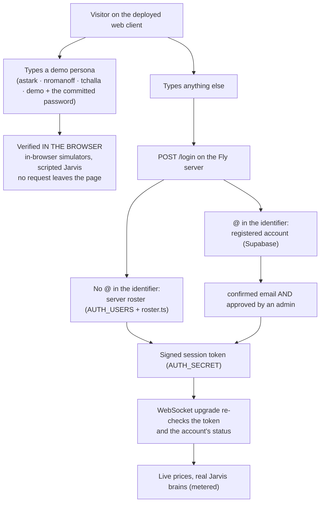
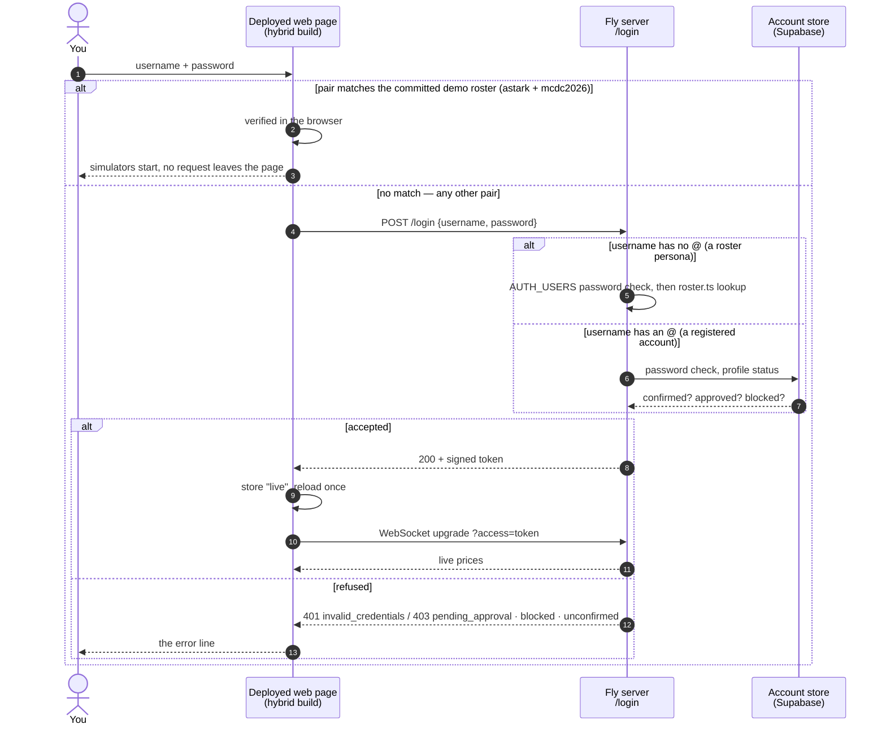

# Security model

How the deployed Reactive Trader clone decides who gets in, what each layer of
defence does and does not do, which risks remain, and an inventory of every
setting and secret the deployment depends on — by name and purpose, never by
value. Read this when something refuses a login, when a secret has to be
rotated, or when a new risk comes up and you want to know whether it is
already covered.

The companion pages hold the detail this page points at:
[`authentication.md`](authentication.md) (the flows, endpoints and limits),
[`DEPLOY.md`](DEPLOY.md) (the rollout steps and the deploy workflow),
[`env-files.md`](env-files.md) (every `.env*` file and environment variable),
[`privacy.md`](privacy.md) (what is stored about a registered user),
[`security-scorecard.md`](security-scorecard.md) (supply-chain posture) and the
two hardening specs,
[`2026-09-27-public-launch-hardening-design.md`](superpowers/specs/2026-09-27-public-launch-hardening-design.md)
and
[`2026-10-13-b2a-hardening-design.md`](superpowers/specs/2026-10-13-b2a-hardening-design.md).
The current instance's state (what is deployed, what is still to do) lives in
[`STATUS.md`](STATUS.md), not here.

## 1. Who reaches what

Three audiences, three paths. The first never touches the server at all.

The decisive design choice is the first fork. A production build carries the
committed demo roster (`VITE_DEMO_AUTH` in each web client's `.env.production`)
and a server URL, and routes by the **whole credential pair**: a username and
password that match the roster are verified locally and run the simulators;
anything else is posted to the server. So the public demo costs nothing on the
server and cannot spend the AI key, while the same page is the real client for
anyone with a real credential ([`authentication.md` §6](authentication.md#6-hybrid-data-source-one-deployment-two-modes)).

### 1.1 One username, two worlds

The confusing case, and the one worth testing yourself: on the deployed page
the same persona name works in **both** worlds, and only the password decides
which. The page matches the *pair* you typed against the committed demo
roster; a match stays in the browser, anything else goes to the server.

Credential by credential, what happens on the deployed page:

| You type | Checked by | Outcome |
|---|---|---|
| `astark` + `mcdc2026` (or any persona with the committed password) | the browser, against `VITE_DEMO_AUTH` | In-browser simulators; nothing is sent to the server. The public demo. |
| `astark` + the **private** password from `AUTH_USERS` | the server: `AUTH_USERS`, then `roster.ts` | Live. The page reloads once into live mode and opens the WebSocket. Only whoever holds that password gets here. |
| `astark` + any other password | the server | `401 invalid_credentials`, one strike against your address. |
| a persona the server roster does not list (today every persona but one) + anything but `mcdc2026` | the server | `401`: no entry in `AUTH_USERS`. |
| a username not in `roster.ts` (`csx`, `admin`, …) + anything | the server | `401`, always, even if `AUTH_USERS` names it (§2.2). |
| `you@example.com` + its password | the server, then the account store | Live if confirmed **and** approved; `403 pending_approval` / `blocked` / `unconfirmed` otherwise; `401` on a wrong password. |
| `you@example.com` on a page **without** a server URL (`pnpm dev`) | the in-browser `AuthSimulator` | Refused: the simulator knows only the demo roster. |

How to tell which world the page landed in: the browser console prints
`[data] composed sim from …` or `[data] composed live from …` at boot; a live
page has one WebSocket to the server in the network panel and none in sim
mode; the login screen's demo-accounts hint lists exactly the pairs the page
verifies locally, so a persona shown there with the printed password is the
simulator. The choice is remembered in `localStorage["rtc.dataSource"]` and
re-decided at every login
([`authentication.md` §6.2](authentication.md#62-reload-dynamics)).

## 2. The three identities

### 2.1 Demo personas, in the browser

The four personas in `packages/domain/src/auth/roster.ts` with the committed
password. They exist for the demo and for local development: every `pnpm dev`
login, every e2e flow and every Reddit visitor uses them. They are safe to
publish because on a deployed page they unlock only the in-browser simulators.
The login screen lists them as a click-to-fill hint, and the password is
printed there on purpose.

### 2.2 Server roster personas — two halves, one of them fixed

A roster login on the server passes **two** checks, in this order:

1. the password, against the `AUTH_USERS` Fly secret (`"user:pass,user2:pass2"`,
   scrypt-hashed at startup, compared in constant time);
2. the username, against the committed roster in `roster.ts`, because the
   session token carries that persona's profile (display name, role, desk,
   clearance) and the server has nowhere else to get it.

The consequence that surprises people: **the username is code, the password
is configuration.** `AUTH_USERS` may name fewer personas than the roster, or
none, and may give each any password — but a username that is not in
`roster.ts` can never log in, whatever `AUTH_USERS` says
([`authentication.md` §3](authentication.md#3-the-four-roster-users--the-profile-dropdown)).
Adding a fifth persona is a code change and a redeploy, and ships that name in
every client bundle. Rotating the server roster therefore means changing a
persona's **password**: on the hybrid client that persona with the committed
password still runs the simulator for everyone, while the same persona with
the private password reaches the server — only whoever holds the private
password can take it live. A deployed server may also carry **no**
`AUTH_USERS` at all once registered accounts work; then no persona reaches it.

### 2.3 Registered accounts

An email address and a password, checked by the server against its account
store — Supabase in production, reached only from the Fly server over plain
`fetch` with a secret key. No client, and neither `@rtc/shared` nor
`@rtc/domain`, ever holds a Supabase URL, key or SDK. A new account is usable
only after **both** gates: the mailbox is confirmed with an 8-digit code the
server mailed, and an administrator has set `approved = true` on the account's
`profiles` row. The password is set together with the code, never at sign-up,
so an attacker cannot pre-register someone else's address with a password of
their choosing. An administrator approves, blocks, unblocks, renames and deletes accounts in
the Users panel; the server re-reads an account's status at every login and,
through a 60-second cache, at every WebSocket upgrade, and the panel's
actions also end the account's open sessions at once
([`authentication.md` §7](authentication.md#7-registered-accounts-b2a),
[§7.10](authentication.md#710-administration-and-ending-sessions-b2c)). Every
admin call is checked on the server against the directory itself, never
against the token. `/mcp` admits only an active administrator.

## 3. The layers, cheapest first

Each row says what the layer stops **and what it does not**, because every one
of them is misread as more than it is.

| Layer | Stops | Does not stop | Where |
|---|---|---|---|
| **Hybrid routing** (§1) | The public demo ever reaching the server: no server cost, no AI spend, no credential to leak. | A real credential being guessed; the demo client is still the real client for one. | `resolveDataSource`, `createRoutingAuthPort` (`@rtc/client-adapters`) |
| **Origin allowlist + JSON content type** on `/login` and the five account routes | A foreign web page using its *visitors' browsers* to drive sign-ups, resends and code entry (browsers set `Origin` themselves, and a cross-origin request with a non-JSON body never preflights). `403 origin_not_allowed`, `415 unsupported_media_type`, no strike. | A script or `curl` forging the header. It is a browser-abuse defence, not an attacker defence; a request with no `Origin` (a script, the RN client) is allowed. | `RTC_ALLOWED_ORIGINS`, `originPolicy.ts` |
| **Credentials** (§2) | Access without a roster password or a confirmed, approved account. | A weak user-chosen password: the policy is 12+ characters with four classes, no breach check. | `AuthService`, `AccountService` |
| **Signed session tokens** | Forging a session: an HMAC over the identity and an expiry, keyed by `AUTH_SECRET`; 8 hours by default. | A roster token cannot be revoked early; it lives until it expires. An account token is ended by a reset, block or rename stamp, except when the stamp write fails after a reset: that revocation then lives only in the server's memory until a restart, and the token works until it expires (at most 8 hours). | `token.ts`, `AUTH_SECRET`, `AUTH_TTL_MS` |
| **Per-IP rate limits and the ban list** | Password and code guessing from one address: 10 logins a minute, 10 code entries per 10 minutes, 5 sign-ups and 5 sends an hour; 10 strikes in 10 minutes bans the address for 15 minutes, checked before any hash or upgrade. Every per-IP budget is also charged against the caller's /48 at four times the budget. | A distributed guesser with many addresses; and the ban is in memory, so a machine restart (scale-to-zero) clears it. One office behind one NAT shares a budget. | `limits.ts`, `rateLimit.ts`, `banList.ts`, `tieredLimiter.ts` |
| **Per-address budgets and the mail fuses** | Mail-bombing one address (3 sends an hour, 5 code attempts per 15 minutes) and exhausting the project's email allowance: 25 sign-ups, 15 resends and 15 resets an hour, server-wide, under the project's 60; a resend or reset is attempted only when the address is in a state where mail would land. | Someone *denying* sign-ups for an hour with 25 junk registrations, or holding the resend path shut. That is the edge challenge's job (§5). | `limits.ts`, `AccountService` |
| **Response-time floor and early answers** | Telling a known address from an unknown one by timing: the three send paths answer `202 code_sent` before any mail is sent, and a failed account login is held to a 300 ms floor. | Enumeration through a different oracle nobody has found yet. | `LOGIN_FAILURE_FLOOR_MS`, `accountHandlers.ts` |
| **Purge of unconfirmed accounts** | Junk accounts accumulating: never-confirmed accounts are deleted 48 hours after creation, hourly. | Confirmed-but-unapproved accounts piling up; those are the admin's to delete. | `PURGE_*` in `limits.ts` |
| **Transport bounds** | A client exhausting the 256 MB machine: WebSocket frames over 256 KiB (1009), bodies over 4 KiB (413), 200 connections total and 8 per IP (503), a 100-frame burst bucket refilling at 25/s with a close after 100 drops (1008), 64 live streams per effect, bounded in-memory stores, every RPC payload validated at the parse seam. | A flood that saturates the network before the app sees it. | `limits.ts`, `connectionGuard.ts`, `tokenBucket.ts`, `guards.ts` |
| **Startup refusals** | Running with a dangerous configuration: a short `AUTH_SECRET` with accounts on, a roster username with `@`, the dev account directory on a deployed machine, a missing origin allowlist on a deployed machine, a malformed `REGISTRATION_OPEN` or sign-up lever. The server exits instead of starting. | A *correct* configuration that is wrong for your intent, such as `REGISTRATION_OPEN=true` by accident. | `resolveAccountsMode.ts`, `originPolicy.ts` |
| **Fly concurrency `hard_limit`** | The proxy handing the machine more than 250 connections, so a flood becomes refused connections instead of an out-of-memory crash. | Fairness between callers; anything per IP. | `fly.toml` |
| **The AI daily budget** | Unbounded Anthropic spend from the server: a per-person daily limit and a house-wide daily cap on the house key, kept durably in the `jarvis_spend_daily` table and added up by the `record_jarvis_spend` function (both private to the server: row security on, no policy, no grants to the public roles). A store that cannot be reached fails closed to the scripted brain. A deployed server (account store on Supabase) always keeps the budget in the database: the wiring picks the durable store for that mode, and a test pins it. The Console spend limit stays the real backstop. | Bring-your-own keys (B3c); one person with many accounts gets many daily limits, bounded by the house cap and the sign-up levers. | `jarvisBudget/`, `RTC_JARVIS_USER_DAILY_USD`, `RTC_JARVIS_HOUSE_DAILY_USD` |
| **Supply chain** | Unpinned actions, images and installers; secrets in the tree; workflow tokens with write scope. | A compromised upstream package inside its pinned version. | `scorecard.yml`, pinned `Dockerfile`, `pnpm audit --prod` gate, push protection |

Two layers are **planned, not built**: Cloudflare in front of the Fly server
(volumetric absorption, edge rate limits and bans, a Turnstile challenge on
sign-up, `RTC_TRUSTED_IP_HEADER=cf-connecting-ip` plus a server check that
drops traffic not from Cloudflare's ranges), and durable per-user metering
with bring-your-own model keys (B3). The first is the only layer that stops a
real flood before it is paid for, and the one that removes the sign-up denial
levers; it needs a custom domain proxied through Cloudflare and a client
redeploy for the new server URL.

## 4. Risks and what tackles them

| Risk | Today | Residual, and who closes it |
|---|---|---|
| The public demo password spends the AI key or loads the server | Hybrid routing; the server roster carries only private passwords. | None, as long as `AUTH_USERS` never again holds the committed password. |
| Password guessing against a roster or email account | scrypt, constant-time compare, 10 logins a minute per IP, the ban list, the /48 bucket. | Distributed guessing; a weak user-chosen password. The edge challenge raises the cost further. |
| Guessing an 8-digit code | 10 entries per 10 minutes per IP and 5 per address per 15 minutes; a wrong code is a strike; codes expire within the hour. | None worth noting: 10⁸ codes against 5 tries per address. |
| A foreign page abusing visitors' browsers | Origin allowlist and the JSON requirement. | A page served from the *victim's own* localhost, if localhost is ever added to the allowlist. |
| Finding out whether an address is registered | Identical `202 code_sent` for known and unknown addresses, mail sent after the answer, the 300 ms login floor. | Any oracle not yet measured; re-measure with the probe's per-call durations after adapter changes. |
| Pre-hijacking: registering someone's address first | No password at sign-up; the password is set with the code; a repeat sign-up of an unconfirmed address resends to the mailbox owner. | None known. |
| Forged or stolen session tokens | HMAC with a 32+ character secret, 8-hour expiry, the upgrade re-check of account status. | B2c closes sessions: a reset, block, rename or delete ends the account's tokens (`iat` against the `sessions_not_before` stamp) and closes its sockets with `4401`. Residual: a stamp that fails after a reset lives only in the server's memory, so a restart forgets it and an old token works until it expires (at most 8 hours); a block or rename made in the Supabase dashboard does not close open sockets. |
| Email allowance exhaustion, lost mail | Per-address budgets, three per-path fuses summing under the project limit, sends attempted only when they would land, the purge. | Supabase answers a spent allowance the same as a per-address throttle, so the server must say "code sent" to both; watch the sender's dashboard in the first days. |
| Denial of new sign-ups by junk registrations | Tunable fuses (`RTC_SIGNUPS_PER_HOUR`, `RTC_SIGNUPS_PER_DAY`) and the purge bound the damage. | 25 junk registrations still close sign-up for an hour; 5 IPs can hold the resend path shut. Removed only by the edge challenge. |
| Volumetric flood | Fly `hard_limit`, the connection caps, the token bucket, the payload caps. | Traffic is still paid for until Cloudflare fronts the server. |
| A blocked user keeps an open socket | Blocking in the Users panel closes the account's sockets at once (`4401`) and stamps the session end. A block made in the Supabase dashboard is re-checked at the next connect within 60 seconds. | A socket already open when the dashboard is used stays open until it reconnects; use the panel, or `fly machine restart`, to drop it at once. |
| Secret leakage from the operator's machine | Secrets live only in Fly, in Supabase and in private files; commands read them with `$(cat …)` so they never appear in a transcript; the deploy workflow holds only deploy tokens. | A value is visible in `ps` for the duration of a `fly secrets set`; the secret files themselves are plaintext on disk. |
| A dependency or action compromised upstream | Pinned digests and lockfiles, the audit gate, Scorecard, push protection. | A compromised upstream *inside* a pinned version. |
| The React Native client | Not hybrid: its login always goes to the server, with the roster password or a registered account. It sends no `Origin`, so the allowlist does not affect it. | The demo personas cannot run live from the mobile app without the private password (open item D7). |

## 5. Inventory

Names and purposes only. The current values and dates belong in
[`STATUS.md`](STATUS.md) and in the operator's private notes; a value never
belongs in this repository.

### 5.1 Fly secrets (`fly secrets list -a <app>`)

Environment variables on the server machine, encrypted at rest, injected at
start. `fly secrets set --stage` stores one without restarting; the next deploy
applies it. Without `--stage` the machine restarts at once.

| Secret | Purpose | Set by | Wrong when |
|---|---|---|---|
| `AUTH_SECRET` | HMAC key that signs and verifies session tokens; 32+ characters with accounts on. | Hand, `openssl rand -hex 32`; nobody needs to know it. | Server refuses to start (too short); every user is signed out once on rotation. |
| `AUTH_USERS` | The server roster, `"persona:password,…"`; usernames must exist in `roster.ts` and may not contain `@`. May be absent. | Hand; the password read from a private file. | A persona login answers 401 with the right password: the username is not in the committed roster. |
| `AUTH_TTL_MS` | Session lifetime, default 8 hours. | Optional. | — |
| `ANTHROPIC_API_KEY` | The real Jarvis brains; absent, Jarvis is the free scripted brain. | Hand. | Jarvis offers only `scripted`. |
| `SUPABASE_URL`, `SUPABASE_SECRET_KEY` | The account store and the secret key that bypasses its row-level security. Both or neither. | Hand, together, the key read from a private file. | `/health/accounts` answers `disabled` (secrets did not reach the machine) or `down` (wrong key or URL, or a paused project). |
| `REGISTRATION_OPEN` | `false` closes `/register` (403 `registration_closed`); `true` or unset opens it; anything else stops the server. | Hand; flipping it restarts the machine. | A `/register` answers 403 when you expected a code. |
| `RTC_ALLOWED_ORIGINS` | Browser origins allowed on `/login` and the account routes; required on a deployed machine. | Hand, the deployed client origins. | Browser logins answer `403 origin_not_allowed`; a missing value stops the server. |
| `RTC_SIGNUPS_PER_HOUR`, `RTC_SIGNUPS_PER_DAY` | The sign-up fuses, defaults 25 and 200. | Optional; unset rather than blank. | `/register` answers 503 `unavailable` with the hourly fuse spent, `registration_closed` over the daily cap. |
| `RTC_TRUSTED_IP_HEADER` | The header carrying the real client address, default `fly-client-ip`; `cf-connecting-ip` once Cloudflare fronts the server. | Optional. | Every limit keys on the proxy's address instead of the caller's. |
| `RTC_JARVIS_USER_DAILY_USD`, `RTC_JARVIS_HOUSE_DAILY_USD`, `RTC_JARVIS_FORCE_GATE`, `RTC_JARVIS_FAKE` | The AI daily limits (a member's, default 0.20; the house's, default 3; `0` is off) and the rehearsal switches (`RTC_JARVIS_FORCE_GATE=exhausted`). The retired `RTC_JARVIS_BUDGET_USD` and `RTC_JARVIS_BUDGET_SOFT_RATIO` do nothing. | Optional. | — |

Configuration that is **not** a secret but shapes the posture: `fly.toml`
(scale-to-zero, the 250-connection `hard_limit`, the `/health` check) and
`packages/server/src/config/limits.ts` (every numeric limit above). The
server's image sets `RTC_DEPLOYED=1`, which together with Fly's own
`FLY_APP_NAME` makes the in-memory dev account directory refuse to start.

### 5.2 Supabase project (dashboard settings, no code)

| Setting | Purpose | Wrong when |
|---|---|---|
| Email provider on, *Confirm email* on, minimum password length 12 | The mailbox gate; the server's rule and the store's agree. | A sign-up confirms without a code; a weak password is accepted. |
| Phone and Anonymous providers off | `profiles.email` is `not null`; such a user would break the profile trigger. | A profile insert fails. |
| Email OTP length **8**, expiry an hour or less | The server refuses any other length before it reaches Supabase. | Every confirmation and reset fails with `invalid_code`. |
| Custom SMTP (the transactional sender), both templates printing `{{ .Token }}` | Supabase's built-in sender allows a couple of mails an hour and drops the rest silently. | Codes never arrive; the project's auth logs show sends without a provider. |
| Email rate limit at least 60 an hour | Above the server's three fuses (55). | Mail is lost silently: Supabase answers a spent allowance like a throttle. |
| IP address forwarding on; CAPTCHA protection off | Per-IP limits apply to the visitor, not the server's one address; a challenge the server cannot solve would turn every sign-in into a strike. | Auth logs show the server's address for every user; or every login fails. |
| Migration `20261004000000_create_profiles.sql` applied; RLS on `public.profiles`, no policies | The profile table only the secret key can reach. | The probe's `ping` fails. |
| Migration `20261024000000_sessions_not_before.sql` applied, and PostgREST's schema cache reloaded | The nullable `sessions_not_before` column the session end reads. Apply it **before** deploying B2c: the new server selects it on every account read. | Every account login reads `unavailable`. |
| A **secret** key (`sb_secret_…`), the publishable key kept private | The server's credential to the store. | `/health/accounts` reads `down`. |

### 5.3 The email sender and DNS

| Item | Purpose | Wrong when |
|---|---|---|
| A sending **subdomain** at the transactional provider, verified with DKIM, SPF and an MX | Codes leave from a domain you control; reputation never touches the root. | The provider shows the domain unverified; codes land in spam or nowhere. |
| A **sending-only** API key at the provider, used as the SMTP password in Supabase | Least privilege: it can send, not read or manage. | — |
| DMARC on the sending subdomain, reporting to a mailbox you read | Spoofing of your sender is reported. | — |
| Email routing for the privacy contact named in `privacy.md` | Deletion and access requests reach a real inbox. | Mail to the contact bounces. |
| A catch-all forward, turned on only for the probe's mail | `accounts:probe` sends one real code to `probe-<timestamp>@<domain>`. | The probe passes but no mail arrives: the catch-all is off, or SMTP in Supabase is wrong. |
| DNS at a registrar you control, DNSSEC where offered | The domain itself is the root of every verification above. | — |

### 5.4 Vercel (the two web clients)

Holds no secret. Each project sets `VITE_SERVER_URL` (the server's `wss://`
address); the demo roster a production build inlines comes from the committed
`.env.production`, not from Vercel. The deploy workflow refuses a build in
which either is missing from the bundle ([`DEPLOY.md`](DEPLOY.md#deploying)).

One team setting serves CI rather than the clients: a **Turborepo CLI OIDC
policy** (Settings → Build and Deployment → OIDC Policies for CLI Access) that
lets workflows in this repository trade their GitHub OIDC token for a
short-lived, cache-only Turborepo token. It is scoped to the repository, not
to a workflow: only `ci.yml`'s `checks` job is granted `id-token: write`, so
only it can ask. It stores nothing; deleting it turns the remote cache off ([ADR-008](adr/ADR-008-ci-turbo-remote-cache.md)).

### 5.5 GitHub repository

| Item | Purpose |
|---|---|
| Actions secrets `FLY_API_TOKEN`, `VERCEL_TOKEN`, `VERCEL_ORG_ID`, the `VERCEL_*_PROJECT_ID`s | Deploy tokens only; no runtime secret and no account-store key is reachable from CI. |
| Actions variable `TURBO_TEAM` (not a secret) and `id-token: write` on `ci.yml`'s `checks` job | The remote cache: the job trades its OIDC token for a cache-only token that is revoked when the job ends; PR runs read the cache and only `main` writes it ([ADR-008](adr/ADR-008-ci-turbo-remote-cache.md)). |
| The `main` ruleset, secret scanning with push protection, read-only default workflow token | Changes land only through a PR; a pasted key is rejected at push. |
| `deploy.yml`, `update-visual-goldens.yml`, `coverage-report.yml` on `workflow_dispatch` only | Nothing deploys or publishes on a merge. |
| `accounts-keepalive.yml` (Monday and Thursday) | Reads `/health/accounts`, which keeps a free-plan project from pausing, and fails on `down`. |

### 5.6 Committed in this repository, on purpose

| Item | Why it is safe |
|---|---|
| The four personas in `roster.ts` and their password in `VITE_DEV_AUTH` / `VITE_DEMO_AUTH` and the `dev:*` scripts | Display data plus a demo credential that, on a deployed page, unlocks only the in-browser simulators. |
| The dev account directory's seeds, password and code `00000000` | Refused on any deployed machine (`FLY_APP_NAME` or `RTC_DEPLOYED`). |
| `dev-local-secret-public-by-design-never-deploy` | The dev scripts' `AUTH_SECRET`; a deploy never runs those scripts. |

### 5.7 The operator's machine

Each credential in its own file in a private folder outside any repository,
mode 600, read into commands with `$(cat …)` so the value never appears in a
shell history or a transcript: the Supabase secret key (needed by the probe
and by a key rotation), the roster password, the administrator account's
password, the DNS provider's API token and the email provider's keys. Fly and
GitHub logins come from their own CLIs' sessions (`fly auth login`,
`gh auth login`). Nothing on this machine is needed for the deployed service
to run; it is needed to operate it. The exact paths are the operator's own
notes, not this page.

## 6. When something refuses: symptom to cause

| Symptom | Likely cause | Check |
|---|---|---|
| `/health/accounts` → `disabled` | The Supabase secrets never reached the machine (staged but not deployed). | `fly secrets list`: `Staged` means deploy or `fly secrets deploy`. |
| `/health/accounts` → `down` | Wrong key or URL, or the project is paused. | The Supabase dashboard; `accounts-keepalive.yml`'s last run. |
| Roster login 401 with the right password | The username is not in `roster.ts`; or `AUTH_USERS` was re-set with a typo. | §2.2; `fly ssh console -C 'sh -c "printenv AUTH_USERS \| cut -c1-8"'` shows the username only. |
| Email login `403 pending_approval` / `blocked` / `unconfirmed` | The account's row, or the mailbox not yet confirmed. | `select approved, blocked from public.profiles where email = …`. |
| Browser login `403 origin_not_allowed` | The page's origin is not in `RTC_ALLOWED_ORIGINS` (a local client against production, a new client host). | The response body; add the origin or use the demo login. |
| `415 unsupported_media_type` | A request without `Content-Type: application/json`. | The caller. |
| `/register` → `403 registration_closed` | `REGISTRATION_OPEN=false`, or the daily cap. | `fly secrets list`; flip it, which restarts the machine. |
| `/register` → `503 unavailable` | The hourly sign-up fuse, or the store down. | `/health/accounts`; wait an hour or raise `RTC_SIGNUPS_PER_HOUR`. |
| `429 rate_limited` / `banned` | The per-IP or per-address budget, or a 15-minute ban after ten strikes. | Wait; the ban clears on its own or on a machine restart. |
| Code never arrives | SMTP in Supabase, the sender's domain, the project's email limit, or a spent per-address budget. | The sender's dashboard, Supabase auth logs, then `accounts:probe` with the catch-all on. |
| The machine will not start after a secret change | One of the startup refusals (§3). | `fly logs -a <app>` names it. |
| Every limit seems shared by everyone | The trusted IP header does not match the proxy in front. | `RTC_TRUSTED_IP_HEADER`; the server's startup log prints which header it trusts. |

## 7. Procedures

- **Rotate `AUTH_SECRET`:** `fly secrets set AUTH_SECRET="$(openssl rand -hex 32)" -a <app>`; everyone logs in again.
- **Rotate a persona's password:** write the new password to its private file, then `fly secrets set AUTH_USERS="<persona>:$(cat <file>)" -a <app>`. The persona must be one of the four in `roster.ts`.
- **Retire the server roster:** `fly secrets unset AUTH_USERS -a <app>`; only registered accounts log in live.
- **Rotate the store key:** create a new secret key in Supabase, `fly secrets set SUPABASE_SECRET_KEY="$(cat <file>)" -a <app>`, then revoke the old key; `/health/accounts` must read `up` afterwards.
- **Open or close sign-up:** `fly secrets set REGISTRATION_OPEN=true|false -a <app>`; a restart, not a deploy.
- **Approve, block, delete:** edit `approved` / `blocked` on the account's `profiles` row; delete the user under Authentication → Users and its profile goes with it. `fly machine restart -a <app>` drops a blocked user's open socket at once.
- **Re-prove the adapter after any change to it:** `accounts:probe` ([`DEPLOY.md` §4](DEPLOY.md#4-supabase-account-store) step 9), with the catch-all on so the mail is seen.
- **If a key is seen in a transcript, a log or a history:** treat it as leaked and rotate it the same day; the two that matter most are `SUPABASE_SECRET_KEY` (bypasses row-level security) and `AUTH_SECRET` (forges any session).

## Related docs

- [`authentication.md`](authentication.md) — the flows, the roster, registered accounts, every limit.
- [`DEPLOY.md`](DEPLOY.md) — the rollout steps and credential rotation.
- [`env-files.md`](env-files.md) — every `.env*` file and environment variable.
- [`privacy.md`](privacy.md) — what is stored about a registered user and the contact for requests.
- [`security-scorecard.md`](security-scorecard.md) — the supply-chain checks.
- [`STATUS.md`](STATUS.md) — the current instance's rollout state and the open security items.
