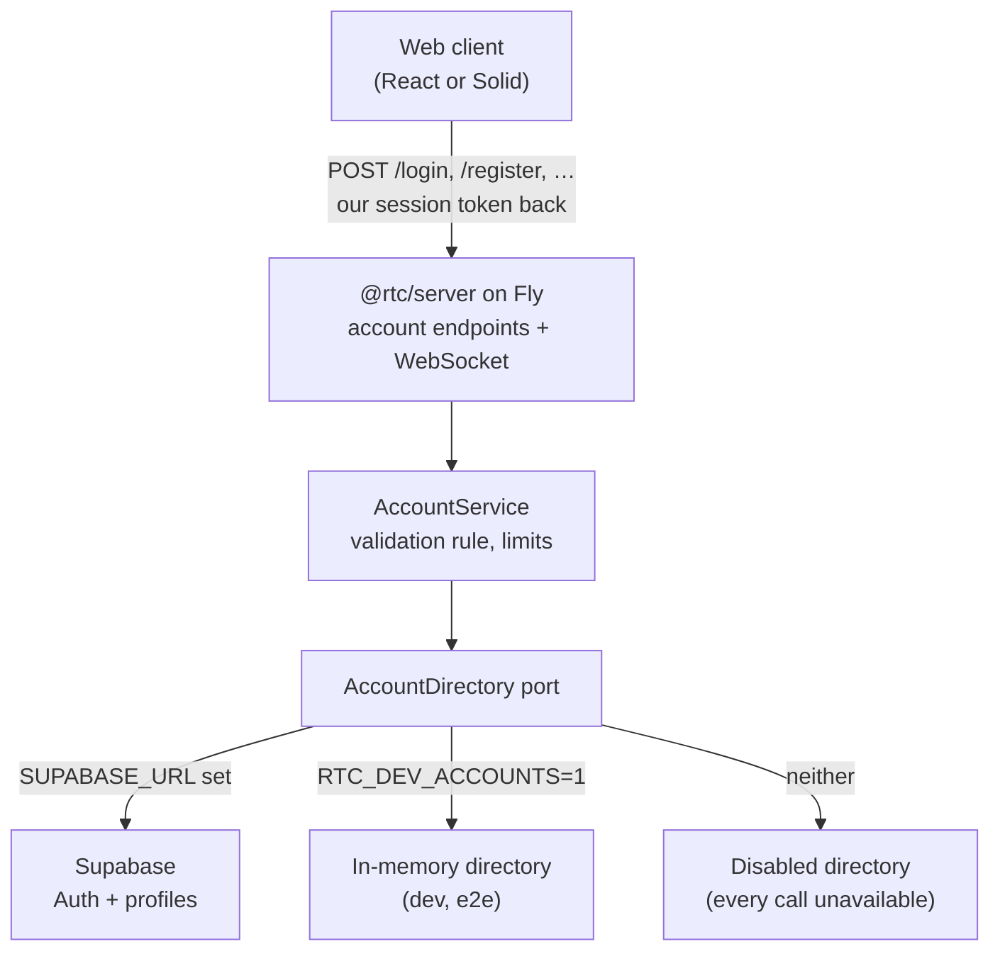

# B2 — user management: design

Date: 2026-10-04 · Status: design approved in conversation, awaiting written-spec review

Parent: [public launch hardening](2026-09-27-public-launch-hardening-design.md)
(§5 B2, decisions D3, D4, D5, finding S12). This document resolves those three
decisions and is the spec the three B2 plans argue from.

**Amended 2026-10-04 during B2a execution.** The design was approved before
B2a was built; review rounds during the build changed it in the places
below, each marked *Amended 2026-10-04* where it sits. The reasoning behind
each change is in the B2a rulings,
[`../plans/2026-10-04-b2a-account-server-rulings.md`](../plans/2026-10-04-b2a-account-server-rulings.md).

- [§3](#3-the-graflyn-rules-this-follows) and
  [§5.3](#53-endpoints): the password is chosen at **email confirmation**,
  not at sign-up (account pre-hijacking).
- [§4](#4-architecture) and [§5.8](#58-dev-e2e-and-the-keep-alive): three
  account modes; the in-memory directory is asked for by name and refused on
  a deployed machine, and the server refuses five kinds of bad configuration
  at startup.
- [§5.1](#51-data-model): no `account_directory` view; `profiles` carries the
  email and its confirmation time.
- [§5.2](#52-components): the components as built, the caller's IP forwarded
  to Supabase, and a rejected key read as unavailable.
- [§5.4](#54-the-login-decision), [§5.5](#55-session-token-identity-and-roles)
  and [§5.6](#56-making-a-block-immediate): what B2a ships and what moves to
  B2c, and `/mcp` refusing every account token in B2a.
- [§5.7](#57-abuse-controls): the input rules, the per-address code limit, and
  what is deliberately not limited.
- [§6](#6-failure-modes): a throttled sign-up reads as sent; a rejected key
  reads as unavailable.
- [§7](#7-client-stage-b2b), [§8](#8-users-panel-and-roles-stage-b2c),
  [§10](#10-testing), [§11](#11-stages), [§12](#12-what-the-user-does) and
  [§13](#13-not-in-b2): what the later stages and the user must now do.

## 1. Intent

A visitor can register, choose a password, and — once their email is confirmed
**and** an administrator has approved them — sign in to the real server with
the real, metered AI. Until then they lose nothing: the hybrid build (parent
§8) lets anyone use the whole app on a demo account with simulated data.
Validation gates only the real server.

The maintainer has no operations time. The design therefore prefers a managed
identity store over self-built password storage, one policy point over two,
and failure modes that degrade to "demo only" instead of "down".

Success is the parent spec's acceptance line, made precise:

- An account that is unconfirmed, unapproved or blocked cannot obtain a session
  token and cannot open a WebSocket.
- Blocking an account ends its live sessions at once.
- A non-admin cannot list, approve, block or delete accounts, and cannot use
  `/mcp`.
- Neither web client ships a Supabase URL, key or SDK.

## 2. Decisions (user, 2026-10-04)

| # | Decision | Chosen | Rejected |
|---|---|---|---|
| D3 / D5 | Where accounts and durable state live | **Supabase** (Auth + Postgres), as in the Graflyn project | Self-built on a Fly volume; OAuth-only sign-in |
| D4 | What "validated" means | **Confirmed email and admin approval** (Graflyn's rule) | Email only; approval only |
| — | Where the admin approves | **An in-app Users panel**, as in Graflyn | Supabase dashboard only; a command-line script |
| — | Who talks to Supabase | **Only the Fly server** ("server-fronted") | Clients using `supabase-js` directly |
| — | Delivery | **Three stages**, B2a → B2b → B2c, one plan each | One plan |

Two operational choices stay with the user and change no code (§12): which
email sender and domain, and whether to prevent free-plan pausing with a
keep-alive workflow (the default this spec builds) or with Supabase Pro.

## 3. The Graflyn rules this follows

Read from `bettersoftware-io/graflyn` on 2026-10-04 (`src/store/auth-store.ts`,
`src/components/auth/AuthPage.tsx`, `supabase/migrations/002_create_profiles.sql`,
`src/lib/admin-api.ts`, `api/lib/auth.ts`).

| Rule | Graflyn | Here |
|---|---|---|
| Identity | Email + password in Supabase Auth | Same |
| Password | ≥ 12 characters, with an uppercase letter, a lowercase letter, a digit and a special character; checked in the browser at sign-up | Same rule, plus a 72-**byte** ceiling (bcrypt reads at most 72 bytes); checked in the form **and enforced on the server**. *Amended 2026-10-04:* chosen with the emailed code, not at sign-up (§5.3) |
| Email confirmation | A link back to `/auth/callback` | A **6-digit code** typed into the app (§5.3) |
| Approval | `profiles.approved` defaults to `false`; an admin sets it on `/admin` | Same, in the Users panel (§8) |
| Block | `profiles.blocked`; admins cannot edit their own row | Same, and a block closes live sockets |
| Roles | `user` / `admin`; the first admin is set by hand in the database | Same |
| Reset | A reset link by email | A 6-digit code by email |
| Enforcement | **Browser only** — the API checks that a token is valid, not that the account is approved | **Server** — the gap is not copied |

## 4. Architecture

*Amended 2026-10-04:* the in-memory directory is never the fallback for an
unset `SUPABASE_URL` — it accepts a fixed code and seeds an admin with a
committed password, so it must be asked for by name (§5.8). With neither
variable set the server runs with a **disabled** directory: registered
logins answer `503 unavailable` and the roster is untouched.

The browser's contract with the server keeps its shape: post credentials, get
**our** HMAC session token, present it on the WebSocket upgrade. Supabase is a
private dependency of the server, as the Anthropic API is. Its own session
tokens are used inside one request and discarded.

Consequences that hold the design together:

- B1's ban list, per-IP rate limits and body caps sit in front of every new
  endpoint, because every new endpoint is ours.
- The hybrid routing (parent §8) is untouched: a credential match against the
  demo roster stays in the browser; everything else goes to `/login`.
- A paused or unreachable Supabase makes registered logins answer
  `unavailable`. Demo accounts never notice.

## 5. Server (stage B2a)

### 5.1 Data model

One Supabase project, London (`eu-west-2`, next to Fly `lhr`), separate from
Graflyn's. Migrations are committed under `supabase/migrations/`.

`public.profiles`:

| Column | Type | Notes |
|---|---|---|
| `id` | `uuid` primary key | References `auth.users(id)`, `ON DELETE CASCADE` |
| `email` | `text not null` | *Amended 2026-10-04.* Copied from `auth.users` |
| `display_name` | `text not null` | From sign-up metadata, trimmed and cut to 40 characters by the trigger (`Guest` when empty) |
| `role` | `text not null default 'user'` | `CHECK (role IN ('user','admin'))` |
| `approved` | `boolean not null default false` | |
| `blocked` | `boolean not null default false` | |
| `email_confirmed_at` | `timestamptz` | *Amended 2026-10-04.* Copied from `auth.users`; null until confirmed |
| `created_at` | `timestamptz not null default now()` | Indexed, for the daily registration count |

- A `SECURITY DEFINER` trigger on `auth.users` insert creates the row. It
  reads only `display_name` from the sign-up metadata and never `role` or
  `approved`, so a sign-up cannot grant itself anything.
- Row-level security is **enabled with no policies**: the `anon` and
  `authenticated` roles can do nothing. Only the server's secret key (which
  bypasses RLS) reads or writes.
- *Amended 2026-10-04 — no view.* A second `SECURITY DEFINER` trigger, on an
  update of `auth.users.email` or `email_confirmed_at`, keeps the two copied
  columns in step, so the server reads one table: account lookups, the Users
  panel and the daily registration count all read `profiles`. The approved
  design had a view `public.account_directory` joining `profiles` to
  `auth.users`; a view over `auth.users` in the exposed schema is the pattern
  Supabase's own security advisor flags, and one table is simpler.

Account status is derived, never stored:

| Status | Condition |
|---|---|
| `unconfirmed` | `email_confirmed_at` is null |
| `pending` | confirmed, `approved = false`, `blocked = false` |
| `active` | confirmed, `approved = true`, `blocked = false` |
| `blocked` | `blocked = true` |

### 5.2 Components

New directory `packages/server/src/accounts/`. Each unit has one job and takes
its collaborators by injection.

| Unit | Job | Depends on |
|---|---|---|
| `AccountDirectory` (interface) | The operations the policy needs: sign up, resend code, confirm email, check password, request reset, reset password, read one account, and the admin set (list, set approved, set blocked, delete) | — |
| `SupabaseAccountDirectory` | Implements it over Supabase's REST endpoints with an injected `fetch` and a 5 s timeout. No SDK. Maps Supabase error codes to the directory's own result types; maps timeouts, 5xx and 540 (project paused) to `unavailable`. *Amended 2026-10-04:* forwards the caller's IP as `Sb-Forwarded-For` (only when it parses as an IP), so Supabase's per-IP limits apply to each visitor, not to our server's one address; reads an HTTP 401, or a 403 without an `error_code`, as `unavailable` — that is the gateway refusing our key, which says nothing about the user — and a 429 on the password check as `unavailable` too | `fetch`, `SUPABASE_URL`, `SUPABASE_SECRET_KEY` |
| `InMemoryAccountDirectory` | The same interface for local dev and e2e: a `Map`, scrypt hashes, a fixed confirmation code. *Amended 2026-10-04:* four seeded accounts, one per status (§5.8) | — |
| `DisabledAccountDirectory` | *Amended 2026-10-04.* The directory of a server with neither mode configured: every call is `unavailable` | — |
| `AccountService` | The policy: input validation, the validation rule (§5.4), the daily registration cap, the registration switch. *Amended 2026-10-04:* and the per-address code-entry limit (§5.7) | `AccountDirectory`, clock |
| `accountStatusCache` | A 60 s cache of account status for the upgrade re-check (§5.6), invalidated by admin actions. *Amended 2026-10-04:* the invalidation lands in B2c with the admin actions | `AccountDirectory`, clock |
| `sessionRegistry` | Live sockets by user id, so a block can close them. *Amended 2026-10-04:* lands in B2c | — |

*Amended 2026-10-04:* B2a's `AccountDirectory` holds only what B2a's
endpoints and the upgrade need — sign up, resend code, confirm email (which
also sets the password), check password, request reset, reset password,
find one account, count registrations since a time, and a health ping. The
admin set (list, set approved, set blocked, delete) joins it in B2c.

The password rule and the email and display-name checks are pure functions in
`@rtc/domain` (`auth/passwordPolicy.ts`, `auth/accountInput.ts`), so the form
shows exactly what the server enforces. The request and response types join
`LoginRequestDto` in `@rtc/shared`'s `protocol/auth.ts`.

`index.ts`'s chain of `if (req.url === …)` becomes a small route table, so six
POST routes share one preflight, one ban check, one body cap and one error
mapping instead of repeating them.

### 5.3 Endpoints

All are `POST`, JSON, CORS-open like `/login`, capped at 4 KiB by bytes
received, behind the ban list and a per-IP rate limit.

*Amended 2026-10-04:* the table as built. `/register` carries no password and
`/confirm-email` carries one (below).

| Endpoint | Body | Success | Failures |
|---|---|---|---|
| `/register` | `email`, `displayName` | `202 {status:"code_sent"}` — **also** for an address that already has an account | `400 invalid_request` (with the failed rule, `email` or `display-name`), `403 registration_closed`, `429`, `503 unavailable` |
| `/resend-code` | `email` | `202 {status:"code_sent"}` for any well-formed address | `400 invalid_request` (rule `email`), `429`, `503` |
| `/confirm-email` | `email`, `code`, `password` | `200 {status:"pending_approval"}`; `200 {status:"password_unset"}` when the email is confirmed but the password was not stored | `400 invalid_request` (with the failed password rule; the code is **not** spent), `400 invalid_code`, `429`, `503` |
| `/login` | `username`, `password` (unchanged) | `200` token, user, expiry (unchanged) | `401 invalid_credentials`, `403 unconfirmed`, `403 pending_approval`, `403 blocked`, `429`, `503 unavailable` |
| `/request-reset` | `email` | `202 {status:"code_sent"}` for any well-formed address | `400 invalid_request` (rule `email`), `429`, `503` |
| `/reset-password` | `email`, `code`, `password` | `200 {status:"password_changed"}` | `400 invalid_code`, `400 invalid_request` (with the failed password rule, or `password` when Supabase refuses one the rule allowed), `429`, `503` |

Every endpoint can also answer `400 malformed_json`, `400 invalid_request`
with no rule (the body has the wrong shape), `413 body_too_large`, `429
banned` with `Retry-After`, and `500 internal_error`. A `429 rate_limited` is
either the per-IP limit (a ban strike) or, on the two code-entry endpoints,
the per-address limit (not a strike; §5.7). Each failure body is `{error,
rule?}`; each success body is `{status}`.

**The password is set by the confirmation** (*amended 2026-10-04*). The
approved design took the password at `/register`. Supabase Auth does not
update an unconfirmed user on a second sign-up for the same address — it
re-sends the code — so the first registrant's password would stand: someone
who registers an address they do not own would hold a working password for
it once its owner confirmed (account pre-hijacking; the B2a review read this
in Supabase Auth's `internal/api/signup.go`). Instead a sign-up stores a
random password nobody knows, and the request that proves the mailbox — the
one carrying the emailed code — carries the real password and sets it. The
password rule is checked before the store is asked, so a weak password does
not spend the code. `password_unset` covers a store that confirms the code
but refuses the password (a stricter project policy, or leaked-password
protection): the address is confirmed and the user finishes through the
reset flow.

The Supabase adapter verifies a confirmation with OTP type `signup`, which
accepts only the sign-up code. Type `email` would also accept a recovery
code, turning `/confirm-email` into a second password-reset path for a
confirmed account.

One residual: an address that someone else registered earlier and never
confirmed keeps that first registrant's display name when its owner
registers and confirms. A display name is not a credential, the
administrator sees it beside the email at approval, and a rename belongs to
B2c.

Codes, not links: the app has no router, a code needs no callback URL or
redirect allowlist, an email scanner cannot spend a one-time link by fetching
it, and the same flow will work on React Native. Supabase's email templates
are switched to print the code (`{{ .Token }}`); the two templates are
committed under `supabase/templates/` and pasted into the dashboard.

`/register`, `/resend-code` and `/request-reset` answer the same way whether
or not the address has an account, so none of them reveals who is registered.

### 5.4 The login decision

`POST /login` with an identifier that contains `@`:

1. Check the password with Supabase. Wrong, or no such account → `401
   invalid_credentials` and a ban strike, as today.
2. Supabase says the email is unconfirmed → `403 unconfirmed`.
3. Read the profile. `blocked` → `403 blocked`. Not `approved` → `403
   pending_approval`.
4. Otherwise sign our token and answer `200`.

`unconfirmed`, `pending_approval` and `blocked` are only ever revealed after a
correct password, so they do not help anyone enumerate accounts.

*Amended 2026-10-04:* the identifier is normalized (trimmed, lowercased)
before any lookup, and one that is not a valid address after that is `401
invalid_credentials` without a store call. A profile row missing for a
correct password is also `401`. Supabase answering the password check with
a 429 is `503 unavailable`, not a wrong password. Since a sign-up no longer
sets a password (§5.3), `403 unconfirmed` is reachable only for an account
whose password was set outside the server's flow; clients still map it.
There is deliberately no per-address limit on password attempts: it would
let anyone lock a named user out by sending wrong passwords on purpose.
`/login` relies on its per-IP limit and the ban list.

An identifier without `@` takes today's path unchanged: the `AUTH_USERS`
roster in `AuthService`. That keeps every `dev:*:fs`, e2e and React Native
flow working, and it is why the demo usernames need no explicit reservation:
registration requires an email address, so a registered identity can never
equal `astark`, `nromanoff`, `tchalla` or `demo`.

### 5.5 Session token, identity and roles

- The token payload gains the account id and access level: `{u, id, a, exp}`
  with `a` in `user | admin`. Roster logins are always `user`.
- `SessionUser` and `SessionUserDto` gain `access: "user" | "admin"`. The
  existing `role` field is a display label ("Senior FX Trader") and stays one.
- A registered user's `SessionUser` is derived on the server: `name` is the
  display name, `initials` from it, `email` the real address, `id` is `USR-`
  plus the first four hex digits of the account id, `role` "Guest Trader" or
  "Desk Administrator", `desk` "Guest · Cloud", `clearance` "LEVEL 2 · DESK"
  or "LEVEL 5 · ADMIN".
- The verified identity (`username`, `id`, `access`) is carried into the
  per-connection services that B1 introduced for S10
  (`scopeServicesToConnection`), so an effect can ask who its caller is. Today
  the upgrade verifies the token and then forgets whose it was.

*Amended 2026-10-04 — what B2a ships.* The token claims as designed: `u` is
the email address for an account session, and a token carries **both** `id`
and `a` or neither (a half-claimed token is refused, never read as a roster
login). An account token is refused under an empty `AUTH_SECRET` both when
it is signed and when it is verified: an HMAC with an empty key is
computable by anyone, so it would forge an admin. `SessionUser.access`, the
connection-scoped identity and `sessionRegistry` land in B2c, where their
first reader (the admin effects) lives; in B2a a block made in the dashboard
applies within the 60-second cache window at the next connect.

*Amended 2026-10-04 — `/mcp` in B2a.* `/mcp` refuses every token that carries
account claims with `403` (`account_tokens_not_accepted`). Only the upgrade
re-checks an account's status, so a since-blocked account's token would
otherwise keep working there until it expired. Registered accounts therefore
have no `/mcp` access in B2a; roster tokens keep today's access, so S12 stays
open for roster logins until B2c's administrator gate (§8).

### 5.6 Making a block immediate

A token lives eight hours, so a block must not wait for it to expire.

- The WebSocket upgrade, after verifying the token, re-checks the account's
  status for registered accounts through `accountStatusCache` (60 s). Anything
  but `active` → `403`. Directory unavailable → `503`: the gate fails closed.
- Blocking or deleting an account through the Users panel invalidates its
  cache entry and closes its live sockets (`1008`, reason `blocked`) through
  `sessionRegistry`.
- The re-check at upgrade is what survives a restart: the machine scales to
  zero, so an in-memory revocation list alone would forget.

Roster tokens skip the re-check; they have no directory entry.

*Amended 2026-10-04 — as built in B2a.* The re-check holds one lookup in
flight per account, so a reconnect storm costs one store call. A lookup that
fails, throws or times out reads as `unavailable` and is never cached as a
verdict; only `active` is admitted, a missing account is `403`, and the
store being unavailable is `503`. The connection caps are checked again after
the awaited lookup. The cache holds at most
`ACCOUNT_STATUS_CACHE_MAX_ENTRIES` (1 000) accounts and drops the oldest
entry past that. The second bullet — invalidating the entry and closing live
sockets — lands in B2c with the admin actions; in B2a a block made in
the dashboard applies within the 60-second cache window at the next connect,
and a socket already open stays open until it reconnects.

### 5.7 Abuse controls

Every value is a named constant in `packages/server/src/config/limits.ts`.

| Limit | Value | Why |
|---|---|---|
| `/register` per IP | 5 per hour | A person registers once |
| `/resend-code`, `/request-reset` per IP | 5 per hour each | Each sends an email |
| `/confirm-email`, `/reset-password` per IP | 10 per 10 minutes each | Bounds guessing a 6-digit code; Supabase also expires and rate-limits codes |
| `/confirm-email` + `/reset-password` per address (*amended 2026-10-04*) | 5 per 15 minutes, one budget shared by both; at most 50 000 addresses held | Bounds guessing from many IPs; see below |
| Registrations per day, whole service | 200 | A fuse against a scripted flood; counted in the database (`profiles.created_at`, *amended 2026-10-04*), so a restart does not reset it |
| `REGISTRATION_OPEN` | env, default `true` | Set to `false` on Fly to close sign-up without a deploy; `/register` answers `403 registration_closed`. *Amended 2026-10-04:* any value but `true` or `false` stops the server at startup, so `0` or `FALSE` cannot leave sign-up silently open |
| Directory call timeout | 5 s | A slow Supabase must not hold a request open |
| Status cache (*amended 2026-10-04*) | 60 s, 1 000 accounts | §5.6 |
| `AUTH_SECRET` length (*amended 2026-10-04*) | at least 32 characters when accounts are enabled | It signs admin sessions; a guessable key forges one |

A rate-limit hit, a failed login and a wrong code are ban strikes, with the
weights B1 set. Logs name the endpoint, the outcome and the IP. They never
contain a password, a code, a token or a request body. An email address is
personal data and is not logged either; the account id is.

*Amended 2026-10-04 — limits as built.* The constants are
`REGISTER_RATE_LIMIT_*`, `SEND_CODE_RATE_LIMIT_*`, `CODE_ENTRY_RATE_LIMIT_*`,
`CODE_ENTRY_PER_ADDRESS_MAX` / `_WINDOW_MS` / `_MAX_KEYS`,
`MAX_REGISTRATIONS_PER_DAY`, `ACCOUNT_DIRECTORY_TIMEOUT_MS`,
`ACCOUNT_STATUS_CACHE_TTL_MS` / `_MAX_ENTRIES`, `AUTH_SECRET_MIN_LENGTH`,
`ACCOUNTS_HEALTH_CACHE_MS` and `ACCOUNT_MAX_BODY_BYTES` (4 KiB). Each
endpoint has its own per-IP limiter. A per-IP rate-limit hit on an account
endpoint is a strike of weight 2 (`account-rate-limited`), a wrong code a
strike of weight 1 (`code-failed`).

- **Per-address code entry.** A code guess is charged to the normalized
  address as well as to the caller's IP, and only for a request that passes
  local validation and reaches the store. Five tries per 15 minutes makes a
  one-in-a-million code unguessable in its lifetime even from many IPs. The
  price, accepted: anyone who can send five well-formed code attempts for an
  address makes that address wait out the window. A per-address refusal is
  `429 rate_limited` but not a ban strike — the caller may be the owner.
- **The daily cap** is exact within one server process: sign-ups still in
  flight, and those answered while the count was being read, are added to
  the stored count. Across several machines it is approximate, since they
  share only the stored count. Over-counting only closes sign-up early.
- **No per-address limit on `/login`** (§5.4): it would hand anyone a way to
  lock a named user out.
- **No `@` in a roster username.** `/login` sends every identifier with an
  `@` to the account service, so `AUTH_USERS` refuses such a username and the
  server does not start.
- **Input rules** (`@rtc/domain`, `auth/accountInput.ts` and
  `auth/passwordPolicy.ts`). An email address is trimmed and lowercased, then
  must be lowercase ASCII in that normal form (an internationalized domain is
  typed in its punycode form) — the validator refuses anything not already
  normalized. A display name is normalized (NFKC, trimmed, inner whitespace
  collapsed) and must then be 2–40 code points with at least one letter or
  digit, no control, format, invisible, private-use or unassigned
  characters, no braille blank, no enclosing mark and no run of four or more
  combining marks. The password rule is unchanged: at least 12 characters, at
  most 72 bytes, an uppercase letter, a lowercase letter, a digit and a
  special character.
- **Logs.** As built, the account endpoints log nothing per request. The
  server logs the IP and the reason when it bans an address, and the route,
  IP and error name when a handler fails with a 500. No account id is logged
  either.

### 5.8 Dev, e2e and the keep-alive

- *Amended 2026-10-04 (approved text: "`SUPABASE_URL` unset →
  `InMemoryAccountDirectory`").* `RTC_DEV_ACCOUNTS=1` → `InMemoryAccountDirectory`,
  **never** `SUPABASE_URL` being unset (that is `disabled`), and refused when
  `FLY_APP_NAME` is set. Its confirmation code is the fixed `000000`, and it
  seeds one account per status, admin included, whose password is committed
  (dev-only, like `mcdc2026`). The `dev:ws` / `dev:*:fs` scripts and the
  full-stack smoke run on it (details below).
- The server refuses to start with `SUPABASE_URL` set and
  `SUPABASE_SECRET_KEY` missing, the same way `AuthService` refuses
  `AUTH_USERS` without `AUTH_SECRET` (*amended 2026-10-04:* and on the other
  refusals listed below).
- `GET /health/accounts` reports `{ok, directory: "up" | "down" |
  "in-memory" | "disabled"}` (*amended 2026-10-04:* `disabled` added) after
  one cheap read, cached 60 s. A scheduled workflow
  (`accounts-keepalive.yml`, twice a week) calls it, which keeps a free-plan
  project from being paused for inactivity. Supabase does not guarantee that
  this prevents pausing; §12 records the alternative.

*Amended 2026-10-04 — modes and startup, as built.* Three modes, and the dev
one is never a default:

| Environment | Mode | `/health/accounts` |
|---|---|---|
| `SUPABASE_URL` + `SUPABASE_SECRET_KEY` | Supabase | `up` or `down` |
| `RTC_DEV_ACCOUNTS=1` (exactly `1`) | in-memory | `in-memory` |
| neither | disabled — registered logins answer `503 unavailable`, the roster is untouched | `disabled` |

The in-memory directory is selected by `RTC_DEV_ACCOUNTS=1`, **never** by
`SUPABASE_URL` being unset (that is `disabled`): it accepts the fixed code
`000000` and seeds an admin whose password is committed, so a deployed
server that fell back to it would hand out admin sessions. The root
`dev:ws` and `dev:*:fs` scripts set it, and the full-stack node smoke runs
the register → confirm → pending journey against it
(`tests/fullstack/accounts-journey.ts`). It seeds four accounts, one per
status — `admin@rtc.test` (admin, active), `trader@rtc.test` (active),
`pending@rtc.test` and `blocked@rtc.test` — all with the password
`Mcdc2026!desk`, since it has no admin API to approve or block with. The
Gherkin suites do not exercise registration in B2a.

The server refuses to start — before it listens, and without echoing any
value — when:

- `RTC_DEV_ACCOUNTS=1` and `FLY_APP_NAME` are both set (Fly sets the latter
  on every machine);
- `RTC_DEV_ACCOUNTS=1` and `SUPABASE_URL` are both set;
- `SUPABASE_URL` is set without `SUPABASE_SECRET_KEY`, or the reverse, or
  `SUPABASE_URL` is not an `https://` URL;
- either account mode is on and `AUTH_SECRET`, trimmed, is shorter than
  `AUTH_SECRET_MIN_LENGTH` (32) characters;
- `REGISTRATION_OPEN` is set to anything but `true` or `false`;
- an `AUTH_USERS` username contains `@` (§5.7), or `AUTH_USERS` is set without
  `AUTH_SECRET` (unchanged from before B2).

`GET /health/accounts` answers `{ok: true, directory}` with one of `up`,
`down`, `in-memory` or `disabled`; only the Supabase mode reads the store,
at most once per `ACCOUNTS_HEALTH_CACHE_MS` (60 s). The keep-alive runs
Monday and Thursday at 07:17 UTC and fails only on `down`.

## 6. Failure modes

| Condition | Behaviour |
|---|---|
| Supabase paused, down or slow | Account endpoints answer `503 unavailable`; the login screen says the live desk is unavailable and that demo accounts still work. Live sockets already open are unaffected until they reconnect. |
| Email sender over its rate limit | *Amended 2026-10-04:* `/register` answers `202 code_sent` and **no email goes out**. Supabase answers a throttled sign-up with `over_email_send_rate_limit` — the same code its per-address limit uses for an address that already has an account — and reading it as anything but "sent" would reveal that the address is registered. `/resend-code` and `/request-reset` likewise read every refusal as sent. The user's way out, once the limit has passed, is to register again or to call `/resend-code`. With Supabase's built-in sender (a couple of emails an hour) a busy hour therefore silently loses sign-ups, which is why a custom SMTP sender is **required** before registration is opened (§12). |
| Supabase rejects our key (rotated, revoked or mistyped) | *Amended 2026-10-04:* an HTTP 401, or a 403 without an `error_code`, is `503 unavailable` at every endpoint — never a wrong password or a bad code, which would strike and eventually ban innocent callers. `/health/accounts` reads `down`. |
| Code expired or wrong | `400 invalid_code`; the form offers resend. |
| Registration closed or over the daily cap | `403 registration_closed`; the form says sign-up is paused. |
| Account deleted while signed in | Sockets closed at deletion; the token fails the upgrade re-check afterwards. *Amended 2026-10-04:* in B2a, sockets are not closed (B2c); the next upgrade is refused once the cached status expires. |
| Server restart mid-flow | Every flow is stateless on our side; the state is in Supabase. |
| Every Supabase sign-in | *Amended 2026-10-04:* each password check — and each verified code — creates a Supabase session row that the server uses within the one request, drops and never revokes. A session time-box in the project's Auth settings (or a later revocation follow-up) keeps that table small. |

## 7. Client (stage B2b)

- `AuthPort` gains `register`, `resendCode`, `confirmEmail`,
  `requestPasswordReset` and `resetPassword`. `AuthOutcome`'s failure reasons
  gain `unconfirmed`, `pending` and `blocked`.
- `HttpAuthAdapter` implements them against §5.3. `AuthSimulator` answers
  `unavailable` (a simulator-only build offers no registration).
  `createRoutingAuthPort` sends all five to the live leg.
- One new machine, `accountAccess`, drives the multi-step flows (create
  account → enter code → awaiting approval; request reset → enter code →
  changed). It is native in all three cores with a suite in
  `@rtc/core-contract`. The `auth` presenter changes only by mapping the new
  failure reasons to messages.
- The login screen in both web clients gains modes — sign in, create account,
  enter code, reset password — in the existing HUD style, with Graflyn's live
  password checklist. `unconfirmed` at sign-in offers the code entry;
  `pending` and `blocked` show a plain message.
- "Create account" and "Forgot password" render only when the build has a
  server URL, through the `ViewModelShell` lane the demo hint used
  (`registrationAvailable`), so no core learns about build configuration.
- A privacy line on the create-account form links the notice (§9).
- New contract specs and goldens for each mode, asserted by both clients. The
  goldens need the user's eyeball acceptance before merge, as D9 did.

*Amended 2026-10-04 — what the B2a contract asks of B2b.* The create-account
step sends only `email` and `displayName`. The client holds the password the
user chose (with the live checklist) until the code step and sends it with
the code to `/confirm-email`. It must render:

- `pending_approval` — the account waits for an administrator;
- `password_unset` — the email is confirmed but no password was stored; send
  the user to the reset flow;
- `400 invalid_request` with a password `rule` — the code was not spent, so
  the same code can be retried with a different password;
- `429 rate_limited` — wait and retry (the response carries no `Retry-After`
  yet; only `429 banned` does);
- `400 invalid_code`, `503 unavailable`, as before.

`AccountErrorDto.rule` is a plain string in B2a (a `PasswordRuleId`, `email`,
`display-name` or `password`); B2b types it.

React Native is out of scope. Its login keeps working against the deployed
server for roster and registered accounts alike, since `/login` keeps its
shape; the three new failure reasons read as a failed sign-in there.

## 8. Users panel and roles (stage B2c)

- Admin-only WebSocket effects: list accounts, set approved, set blocked,
  delete. Each checks the connection identity's `access`; a non-admin gets a
  nack. Any edit to the caller's own account is refused (Graflyn's rule).
- A Users panel in the Admin workspace, rendered only when the signed-in
  user's `access` is `admin`: email, display name, joined date and status, with
  Approve, Block / Unblock and Delete. Pending accounts sort first; the panel
  head shows the pending count.
- One new presenter (the list) and one new machine (the per-row action with
  its in-flight and failed states), native in all three cores with contract
  suites, in both web clients, with contract specs and goldens.
- Changing someone's role is a manual edit in Supabase. The first admin is
  set by hand once (§12).
- `/mcp` requires `access: "admin"` on the bearer token. This closes S12:
  `execute_trade` without a confirmation step is no longer reachable by every
  login. *Amended 2026-10-04:* in B2a `/mcp` refuses every account token
  (§5.5), so the gate B2c adds replaces that refusal and must check the
  account's **current** status, not only the token's claim.

There is no notification when someone registers. The pending count in the
panel is the signal.

*Amended 2026-10-04 — two findings for the Users panel.* Display names from
other scripts that look like Latin letters pass validation (§5.7 rules out
invisible and stacked characters, not lookalikes), so the panel must show
the email beside the name. And a display name can belong to an earlier,
never-confirmed registrant of the same address (§5.3), so the panel is where
a rename belongs.

## 9. Privacy

B2 stores personal data for the first time: an email address and a display
name per account (the password hash is held by Supabase Auth and never seen
by our code after the request that sets it).

- `docs/privacy.md` states what is stored, why, where (Supabase, London), and
  how to have it deleted (ask the maintainer). The create-account form links
  it.
- Deletion is the Delete action in the Users panel, which removes the
  `auth.users` row and, by cascade, the profile. Before B2c it is done in the
  Supabase dashboard.

## 10. Testing

- `AccountService` and the handlers are tested against a fake directory; the
  Supabase adapter against an injected `fetch` that replays Supabase's
  responses, including its error codes, 540 and a timeout.
- Every rule in §5.4, §5.6 and §5.7 has a test that a wrong implementation
  fails, proven with `pnpm mutation-check`. Rate limits and the status cache
  take an injected clock or run under fake timers.
- `tests/fullstack/node-smoke.ts` gains a registration journey over the real
  server with the in-memory directory: register, confirm, refused while
  pending, approved, signed in, blocked, socket closed. *Amended 2026-10-04:*
  as built (`tests/fullstack/accounts-journey.ts`), B2a has no admin API, so
  the journey registers and confirms a new address and sees it refused while
  pending, then uses the seeded accounts: the blocked one is refused, the
  active one signs in, opens a WebSocket, is refused on `/mcp` and resets
  its password. Approving and closing a socket on block join it in B2c.
- *Amended 2026-10-04:* `pnpm --filter @rtc/server accounts:probe`
  (`packages/server/scripts/probe-accounts.ts`) drives the Supabase adapter
  against a real project, because the unit tests can only replay the
  responses Supabase documents. It has not yet been run against a real
  project, so until it prints `PASS` the adapter's agreement with Supabase's
  real answers is unproven.
- The migrations are checked by a test that the committed SQL enables RLS on
  `profiles` and defines no policy, so a later edit cannot quietly open it.
- B2b and B2c follow the repo's tiers: contract specs shared by both clients,
  goldens generated from React and asserted by Solid, a suite per new member
  in `@rtc/core-contract`.

## 11. Stages

| Stage | Ships | Usable alone |
|---|---|---|
| **B2a** | Migrations, `accounts/`, the six endpoints, token claims, upgrade re-check, limits, keep-alive, the probe script, privacy notice, docs (*amended 2026-10-04*: the identity on each connection moves to B2c) | Yes, with `curl`; approval in the Supabase dashboard |
| **B2b** | `AuthPort` additions, `accountAccess` in three cores, login-screen modes in both clients, goldens | Yes; approval in the dashboard |
| **B2c** | Admin effects, Users panel in three cores and both clients, `/mcp` admin gate (*amended 2026-10-04*: plus `SessionUser.access`, the identity on each connection, `sessionRegistry` and the status cache's invalidation) | Completes B2 |

Each stage gets its own plan, review and PR train. B2a's token change is
backward-compatible for clients (they treat the token as opaque), so the
stages can deploy independently.

Acceptance for B2 as a whole is §1's four lines plus: the full gauntlet and
e2e green on every PR, and the user's acceptance of the B2b and B2c goldens.

## 12. What the user does

None of this happens on its own, and none of it is done by the implementation.

| When | Step |
|---|---|
| Before B2a deploys | Create the Supabase project (or approve its creation through the connected tools) and apply the migrations |
| Before B2a deploys | Choose an email sender and a domain, add its DNS records, and enter the SMTP settings in Supabase. The built-in sender allows only a couple of emails an hour and is for testing. *Amended 2026-10-04:* a custom sender is **required** before registration is opened, not optional — a throttled sign-up answers "code sent" and sends nothing (§6) |
| Before B2a deploys | Paste the two email templates from `supabase/templates/`; set the password minimum to 12 in Supabase's settings |
| Before B2a deploys | *Amended 2026-10-04.* Keep the **phone** and **anonymous** sign-in providers disabled (`profiles.email` is `not null`, so such a user breaks the profile trigger); keep the project URL private and do not hand out the publishable key — a direct `/auth/v1/signup` bypasses the server's rules, though such an account still needs approval and cannot read `profiles` |
| Before B2a deploys | *Amended 2026-10-04.* Enable IP address forwarding in the project's Auth rate-limit settings, so `Sb-Forwarded-For` is honoured |
| Before B2a deploys | *Amended 2026-10-04.* Set a session time-box in the project's Auth settings: every sign-in leaves a Supabase session row the server never revokes (§6) |
| Before B2a deploys | *Amended 2026-10-04.* Run `pnpm --filter @rtc/server accounts:probe` with `SUPABASE_URL`, `SUPABASE_SECRET_KEY` and `PROBE_EMAIL_DOMAIN` (a domain you control or a test inbox; the probe sends one real confirmation email there) and see `PASS`. It prints the id of each account it creates and deletes |
| Before B2a deploys | *Amended 2026-10-04.* Make sure `AUTH_SECRET` is at least 32 characters and no `AUTH_USERS` username contains `@`; the server refuses to start otherwise (§5.8) |
| Before B2a deploys | `flyctl secrets set SUPABASE_URL=… SUPABASE_SECRET_KEY=…` |
| After the first sign-up | Mark your own account `role = 'admin'`, `approved = true` in the table editor |
| Any time | Decide between the keep-alive workflow (built by default) and Supabase Pro, which removes pausing outright |
| Any time | Redeploy (`deploy.yml` is dispatch-only) |

## 13. Not in B2

- Self-service account deletion or email change.
- A captcha. Approval is the gate, and an unconfirmed sign-up costs one email;
  Cloudflare Turnstile is the follow-up if sign-up is abused.
- A notification to the admin on sign-up.
- Registration screens in the React Native client (parent D7 stays open).
- Per-user AI budgets and bring-your-own keys: that is B3, which reuses this
  project's Postgres and the identity B2a puts on each connection.
  *Amended 2026-10-04:* that identity now lands in B2c (§5.5).
- *Amended 2026-10-04.* Detecting lookalike display names from other
  scripts; the Users panel shows the email beside the name instead (§8).
