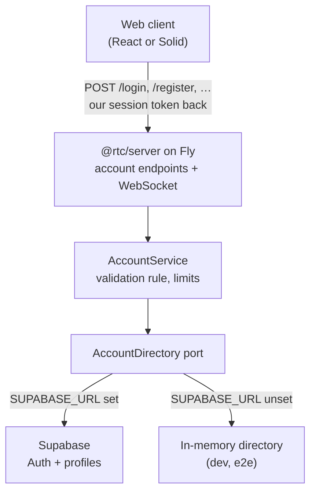

# B2 — user management: design

Date: 2026-10-04 · Status: design approved in conversation, awaiting written-spec review

Parent: [public launch hardening](2026-09-27-public-launch-hardening-design.md)
(§5 B2, decisions D3, D4, D5, finding S12). This document resolves those three
decisions and is the spec the three B2 plans argue from.

## 1. Intent

A visitor can register, choose a password, and — once their email is confirmed
**and** an administrator has approved them — sign in to the real server with
the real, metered AI. Until then they lose nothing: the hybrid build (parent
§8) lets anyone use the whole app on a demo account with simulated data.
Validation gates only the real server.

The maintainer has no operations time. The design therefore prefers a managed
identity store over self-built password storage, one policy point over two,
and failure modes that degrade to "demo only" instead of "down".

Success is the parent spec's acceptance line, made precise:

- An account that is unconfirmed, unapproved or blocked cannot obtain a session
  token and cannot open a WebSocket.
- Blocking an account ends its live sessions at once.
- A non-admin cannot list, approve, block or delete accounts, and cannot use
  `/mcp`.
- Neither web client ships a Supabase URL, key or SDK.

## 2. Decisions (user, 2026-10-04)

| # | Decision | Chosen | Rejected |
|---|---|---|---|
| D3 / D5 | Where accounts and durable state live | **Supabase** (Auth + Postgres), as in the Graflyn project | Self-built on a Fly volume; OAuth-only sign-in |
| D4 | What "validated" means | **Confirmed email and admin approval** (Graflyn's rule) | Email only; approval only |
| — | Where the admin approves | **An in-app Users panel**, as in Graflyn | Supabase dashboard only; a command-line script |
| — | Who talks to Supabase | **Only the Fly server** ("server-fronted") | Clients using `supabase-js` directly |
| — | Delivery | **Three stages**, B2a → B2b → B2c, one plan each | One plan |

Two operational choices stay with the user and change no code (§12): which
email sender and domain, and whether to prevent free-plan pausing with a
keep-alive workflow (the default this spec builds) or with Supabase Pro.

## 3. The Graflyn rules this follows

Read from `bettersoftware-io/graflyn` on 2026-10-04 (`src/store/auth-store.ts`,
`src/components/auth/AuthPage.tsx`, `supabase/migrations/002_create_profiles.sql`,
`src/lib/admin-api.ts`, `api/lib/auth.ts`).

| Rule | Graflyn | Here |
|---|---|---|
| Identity | Email + password in Supabase Auth | Same |
| Password | ≥ 12 characters, with an uppercase letter, a lowercase letter, a digit and a special character; checked in the browser at sign-up | Same rule, plus a 72-character ceiling (Supabase's hashing limit); checked in the form **and enforced on the server** |
| Email confirmation | A link back to `/auth/callback` | A **6-digit code** typed into the app (§5.3) |
| Approval | `profiles.approved` defaults to `false`; an admin sets it on `/admin` | Same, in the Users panel (§8) |
| Block | `profiles.blocked`; admins cannot edit their own row | Same, and a block closes live sockets |
| Roles | `user` / `admin`; the first admin is set by hand in the database | Same |
| Reset | A reset link by email | A 6-digit code by email |
| Enforcement | **Browser only** — the API checks that a token is valid, not that the account is approved | **Server** — the gap is not copied |

## 4. Architecture

The browser's contract with the server keeps its shape: post credentials, get
**our** HMAC session token, present it on the WebSocket upgrade. Supabase is a
private dependency of the server, as the Anthropic API is. Its own session
tokens are used inside one request and discarded.

Consequences that hold the design together:

- B1's ban list, per-IP rate limits and body caps sit in front of every new
  endpoint, because every new endpoint is ours.
- The hybrid routing (parent §8) is untouched: a credential match against the
  demo roster stays in the browser; everything else goes to `/login`.
- A paused or unreachable Supabase makes registered logins answer
  `unavailable`. Demo accounts never notice.

## 5. Server (stage B2a)

### 5.1 Data model

One Supabase project, London (`eu-west-2`, next to Fly `lhr`), separate from
Graflyn's. Migrations are committed under `supabase/migrations/`.

`public.profiles`:

| Column | Type | Notes |
|---|---|---|
| `id` | `uuid` primary key | References `auth.users(id)`, `ON DELETE CASCADE` |
| `display_name` | `text not null` | From sign-up metadata, trimmed and cut to 40 characters by the trigger |
| `role` | `text not null default 'user'` | `CHECK (role IN ('user','admin'))` |
| `approved` | `boolean not null default false` | |
| `blocked` | `boolean not null default false` | |
| `created_at` | `timestamptz not null default now()` | |

- A `SECURITY DEFINER` trigger on `auth.users` insert creates the row. It
  reads only `display_name` from the sign-up metadata and never `role` or
  `approved`, so a sign-up cannot grant itself anything.
- Row-level security is **enabled with no policies**: the `anon` and
  `authenticated` roles can do nothing. Only the server's secret key (which
  bypasses RLS) reads or writes.
- A view `public.account_directory` joins `profiles` to `auth.users` for
  `email` and `email_confirmed_at`. `SELECT` is revoked from `anon` and
  `authenticated` and granted to `service_role` only. The Users panel and the
  daily registration count read it.

Account status is derived, never stored:

| Status | Condition |
|---|---|
| `unconfirmed` | `email_confirmed_at` is null |
| `pending` | confirmed, `approved = false`, `blocked = false` |
| `active` | confirmed, `approved = true`, `blocked = false` |
| `blocked` | `blocked = true` |

### 5.2 Components

New directory `packages/server/src/accounts/`. Each unit has one job and takes
its collaborators by injection.

| Unit | Job | Depends on |
|---|---|---|
| `AccountDirectory` (interface) | The operations the policy needs: sign up, resend code, confirm email, check password, request reset, reset password, read one account, and the admin set (list, set approved, set blocked, delete) | — |
| `SupabaseAccountDirectory` | Implements it over Supabase's REST endpoints with an injected `fetch` and a 5 s timeout. No SDK. Maps Supabase error codes to the directory's own result types; maps timeouts, 5xx and 540 (project paused) to `unavailable` | `fetch`, `SUPABASE_URL`, `SUPABASE_SECRET_KEY` |
| `InMemoryAccountDirectory` | The same interface for local dev and e2e: a `Map`, scrypt hashes, a fixed confirmation code, one seeded admin | — |
| `AccountService` | The policy: input validation, the validation rule (§5.4), the daily registration cap, the registration switch | `AccountDirectory`, clock |
| `accountStatusCache` | A 60 s cache of account status for the upgrade re-check (§5.6), invalidated by admin actions | `AccountDirectory`, clock |
| `sessionRegistry` | Live sockets by user id, so a block can close them | — |

The password rule and the email and display-name checks are pure functions in
`@rtc/domain` (`auth/passwordPolicy.ts`, `auth/accountInput.ts`), so the form
shows exactly what the server enforces. The request and response types join
`LoginRequestDto` in `@rtc/shared`'s `protocol/auth.ts`.

`index.ts`'s chain of `if (req.url === …)` becomes a small route table, so six
POST routes share one preflight, one ban check, one body cap and one error
mapping instead of repeating them.

### 5.3 Endpoints

All are `POST`, JSON, CORS-open like `/login`, capped at 4 KiB by bytes
received, behind the ban list and a per-IP rate limit.

| Endpoint | Body | Success | Failures |
|---|---|---|---|
| `/register` | `email`, `displayName`, `password` | `202 {status:"code_sent"}` — **also** for an address that already has an account | `400 invalid_request` (with the failed rule), `403 registration_closed`, `429`, `503 unavailable` |
| `/resend-code` | `email` | `202 {status:"code_sent"}` always | `429`, `503` |
| `/confirm-email` | `email`, `code` | `200 {status:"pending_approval"}` | `400 invalid_code`, `429`, `503` |
| `/login` | `username`, `password` (unchanged) | `200` token, user, expiry (unchanged) | `401 invalid_credentials`, `403 unconfirmed`, `403 pending_approval`, `403 blocked`, `429`, `503 unavailable` |
| `/request-reset` | `email` | `202 {status:"code_sent"}` always | `429`, `503` |
| `/reset-password` | `email`, `code`, `password` | `200 {status:"password_changed"}` | `400 invalid_code`, `400 invalid_request`, `429`, `503` |

Codes, not links: the app has no router, a code needs no callback URL or
redirect allowlist, an email scanner cannot spend a one-time link by fetching
it, and the same flow will work on React Native. Supabase's email templates
are switched to print the code (`{{ .Token }}`); the two templates are
committed under `supabase/templates/` and pasted into the dashboard.

`/register`, `/resend-code` and `/request-reset` answer the same way whether
or not the address has an account, so none of them reveals who is registered.

### 5.4 The login decision

`POST /login` with an identifier that contains `@`:

1. Check the password with Supabase. Wrong, or no such account → `401
   invalid_credentials` and a ban strike, as today.
2. Supabase says the email is unconfirmed → `403 unconfirmed`.
3. Read the profile. `blocked` → `403 blocked`. Not `approved` → `403
   pending_approval`.
4. Otherwise sign our token and answer `200`.

`unconfirmed`, `pending_approval` and `blocked` are only ever revealed after a
correct password, so they do not help anyone enumerate accounts.

An identifier without `@` takes today's path unchanged: the `AUTH_USERS`
roster in `AuthService`. That keeps every `dev:*:fs`, e2e and React Native
flow working, and it is why the demo usernames need no explicit reservation:
registration requires an email address, so a registered identity can never
equal `astark`, `nromanoff`, `tchalla` or `demo`.

### 5.5 Session token, identity and roles

- The token payload gains the account id and access level: `{u, id, a, exp}`
  with `a` in `user | admin`. Roster logins are always `user`.
- `SessionUser` and `SessionUserDto` gain `access: "user" | "admin"`. The
  existing `role` field is a display label ("Senior FX Trader") and stays one.
- A registered user's `SessionUser` is derived on the server: `name` is the
  display name, `initials` from it, `email` the real address, `id` is `USR-`
  plus the first four hex digits of the account id, `role` "Guest Trader" or
  "Desk Administrator", `desk` "Guest · Cloud", `clearance` "LEVEL 2 · DESK"
  or "LEVEL 5 · ADMIN".
- The verified identity (`username`, `id`, `access`) is carried into the
  per-connection services that B1 introduced for S10
  (`scopeServicesToConnection`), so an effect can ask who its caller is. Today
  the upgrade verifies the token and then forgets whose it was.

### 5.6 Making a block immediate

A token lives eight hours, so a block must not wait for it to expire.

- The WebSocket upgrade, after verifying the token, re-checks the account's
  status for registered accounts through `accountStatusCache` (60 s). Anything
  but `active` → `403`. Directory unavailable → `503`: the gate fails closed.
- Blocking or deleting an account through the Users panel invalidates its
  cache entry and closes its live sockets (`1008`, reason `blocked`) through
  `sessionRegistry`.
- The re-check at upgrade is what survives a restart: the machine scales to
  zero, so an in-memory revocation list alone would forget.

Roster tokens skip the re-check; they have no directory entry.

### 5.7 Abuse controls

Every value is a named constant in `packages/server/src/config/limits.ts`.

| Limit | Value | Why |
|---|---|---|
| `/register` per IP | 5 per hour | A person registers once |
| `/resend-code`, `/request-reset` per IP | 5 per hour each | Each sends an email |
| `/confirm-email`, `/reset-password` per IP | 10 per 10 minutes each | Bounds guessing a 6-digit code; Supabase also expires and rate-limits codes |
| Registrations per day, whole service | 200 | A fuse against a scripted flood; counted in the database (`account_directory`), so a restart does not reset it |
| `REGISTRATION_OPEN` | env, default `true` | Set to `false` on Fly to close sign-up without a deploy; `/register` answers `403 registration_closed` |
| Directory call timeout | 5 s | A slow Supabase must not hold a request open |

A rate-limit hit, a failed login and a wrong code are ban strikes, with the
weights B1 set. Logs name the endpoint, the outcome and the IP. They never
contain a password, a code, a token or a request body. An email address is
personal data and is not logged either; the account id is.

### 5.8 Dev, e2e and the keep-alive

- `SUPABASE_URL` unset → `InMemoryAccountDirectory`. Its confirmation code is
  the fixed `000000`, and it seeds one admin and one approved user whose
  credentials are committed next to the demo roster (dev-only, like
  `mcdc2026`). `dev:*:fs` and the Gherkin suites exercise registration,
  approval and blocking without a network.
- The server refuses to start with `SUPABASE_URL` set and
  `SUPABASE_SECRET_KEY` missing, the same way `AuthService` refuses
  `AUTH_USERS` without `AUTH_SECRET`.
- `GET /health/accounts` reports `{ok, directory: "up" | "down" |
  "in-memory"}` after one cheap read, cached 60 s. A scheduled workflow
  (`accounts-keepalive.yml`, twice a week) calls it, which keeps a free-plan
  project from being paused for inactivity. Supabase does not guarantee that
  this prevents pausing; §12 records the alternative.

## 6. Failure modes

| Condition | Behaviour |
|---|---|
| Supabase paused, down or slow | Account endpoints answer `503 unavailable`; the login screen says the live desk is unavailable and that demo accounts still work. Live sockets already open are unaffected until they reconnect. |
| Email sender over its rate limit | `/register` answers `503 unavailable` and can be retried later. `/resend-code` covers the case where the account was created but its email was not sent. |
| Code expired or wrong | `400 invalid_code`; the form offers resend. |
| Registration closed or over the daily cap | `403 registration_closed`; the form says sign-up is paused. |
| Account deleted while signed in | Sockets closed at deletion; the token fails the upgrade re-check afterwards. |
| Server restart mid-flow | Every flow is stateless on our side; the state is in Supabase. |

## 7. Client (stage B2b)

- `AuthPort` gains `register`, `resendCode`, `confirmEmail`,
  `requestPasswordReset` and `resetPassword`. `AuthOutcome`'s failure reasons
  gain `unconfirmed`, `pending` and `blocked`.
- `HttpAuthAdapter` implements them against §5.3. `AuthSimulator` answers
  `unavailable` (a simulator-only build offers no registration).
  `createRoutingAuthPort` sends all five to the live leg.
- One new machine, `accountAccess`, drives the multi-step flows (create
  account → enter code → awaiting approval; request reset → enter code →
  changed). It is native in all three cores with a suite in
  `@rtc/core-contract`. The `auth` presenter changes only by mapping the new
  failure reasons to messages.
- The login screen in both web clients gains modes — sign in, create account,
  enter code, reset password — in the existing HUD style, with Graflyn's live
  password checklist. `unconfirmed` at sign-in offers the code entry;
  `pending` and `blocked` show a plain message.
- "Create account" and "Forgot password" render only when the build has a
  server URL, through the `ViewModelShell` lane the demo hint used
  (`registrationAvailable`), so no core learns about build configuration.
- A privacy line on the create-account form links the notice (§9).
- New contract specs and goldens for each mode, asserted by both clients. The
  goldens need the user's eyeball acceptance before merge, as D9 did.

React Native is out of scope. Its login keeps working against the deployed
server for roster and registered accounts alike, since `/login` keeps its
shape; the three new failure reasons read as a failed sign-in there.

## 8. Users panel and roles (stage B2c)

- Admin-only WebSocket effects: list accounts, set approved, set blocked,
  delete. Each checks the connection identity's `access`; a non-admin gets a
  nack. Any edit to the caller's own account is refused (Graflyn's rule).
- A Users panel in the Admin workspace, rendered only when the signed-in
  user's `access` is `admin`: email, display name, joined date and status, with
  Approve, Block / Unblock and Delete. Pending accounts sort first; the panel
  head shows the pending count.
- One new presenter (the list) and one new machine (the per-row action with
  its in-flight and failed states), native in all three cores with contract
  suites, in both web clients, with contract specs and goldens.
- Changing someone's role is a manual edit in Supabase. The first admin is
  set by hand once (§12).
- `/mcp` requires `access: "admin"` on the bearer token. This closes S12:
  `execute_trade` without a confirmation step is no longer reachable by every
  login.

There is no notification when someone registers. The pending count in the
panel is the signal.

## 9. Privacy

B2 stores personal data for the first time: an email address and a display
name per account (the password hash is held by Supabase Auth and never seen
by our code after the request that sets it).

- `docs/privacy.md` states what is stored, why, where (Supabase, London), and
  how to have it deleted (ask the maintainer). The create-account form links
  it.
- Deletion is the Delete action in the Users panel, which removes the
  `auth.users` row and, by cascade, the profile. Before B2c it is done in the
  Supabase dashboard.

## 10. Testing

- `AccountService` and the handlers are tested against a fake directory; the
  Supabase adapter against an injected `fetch` that replays Supabase's
  responses, including its error codes, 540 and a timeout.
- Every rule in §5.4, §5.6 and §5.7 has a test that a wrong implementation
  fails, proven with `pnpm mutation-check`. Rate limits and the status cache
  take an injected clock or run under fake timers.
- `tests/fullstack/node-smoke.ts` gains a registration journey over the real
  server with the in-memory directory: register, confirm, refused while
  pending, approved, signed in, blocked, socket closed.
- The migrations are checked by a test that the committed SQL enables RLS on
  `profiles` and defines no policy, so a later edit cannot quietly open it.
- B2b and B2c follow the repo's tiers: contract specs shared by both clients,
  goldens generated from React and asserted by Solid, a suite per new member
  in `@rtc/core-contract`.

## 11. Stages

| Stage | Ships | Usable alone |
|---|---|---|
| **B2a** | Migrations, `accounts/`, the six endpoints, token and identity changes, upgrade re-check, limits, keep-alive, privacy notice, docs | Yes, with `curl`; approval in the Supabase dashboard |
| **B2b** | `AuthPort` additions, `accountAccess` in three cores, login-screen modes in both clients, goldens | Yes; approval in the dashboard |
| **B2c** | Admin effects, Users panel in three cores and both clients, `/mcp` admin gate | Completes B2 |

Each stage gets its own plan, review and PR train. B2a's token change is
backward-compatible for clients (they treat the token as opaque), so the
stages can deploy independently.

Acceptance for B2 as a whole is §1's four lines plus: the full gauntlet and
e2e green on every PR, and the user's acceptance of the B2b and B2c goldens.

## 12. What the user does

None of this happens on its own, and none of it is done by the implementation.

| When | Step |
|---|---|
| Before B2a deploys | Create the Supabase project (or approve its creation through the connected tools) and apply the migrations |
| Before B2a deploys | Choose an email sender and a domain, add its DNS records, and enter the SMTP settings in Supabase. The built-in sender allows only a couple of emails an hour and is for testing. |
| Before B2a deploys | Paste the two email templates from `supabase/templates/`; set the password minimum to 12 in Supabase's settings |
| Before B2a deploys | `flyctl secrets set SUPABASE_URL=… SUPABASE_SECRET_KEY=…` |
| After the first sign-up | Mark your own account `role = 'admin'`, `approved = true` in the table editor |
| Any time | Decide between the keep-alive workflow (built by default) and Supabase Pro, which removes pausing outright |
| Any time | Redeploy (`deploy.yml` is dispatch-only) |

## 13. Not in B2

- Self-service account deletion or email change.
- A captcha. Approval is the gate, and an unconfirmed sign-up costs one email;
  Cloudflare Turnstile is the follow-up if sign-up is abused.
- A notification to the admin on sign-up.
- Registration screens in the React Native client (parent D7 stays open).
- Per-user AI budgets and bring-your-own keys: that is B3, which reuses this
  project's Postgres and the identity B2a puts on each connection.
