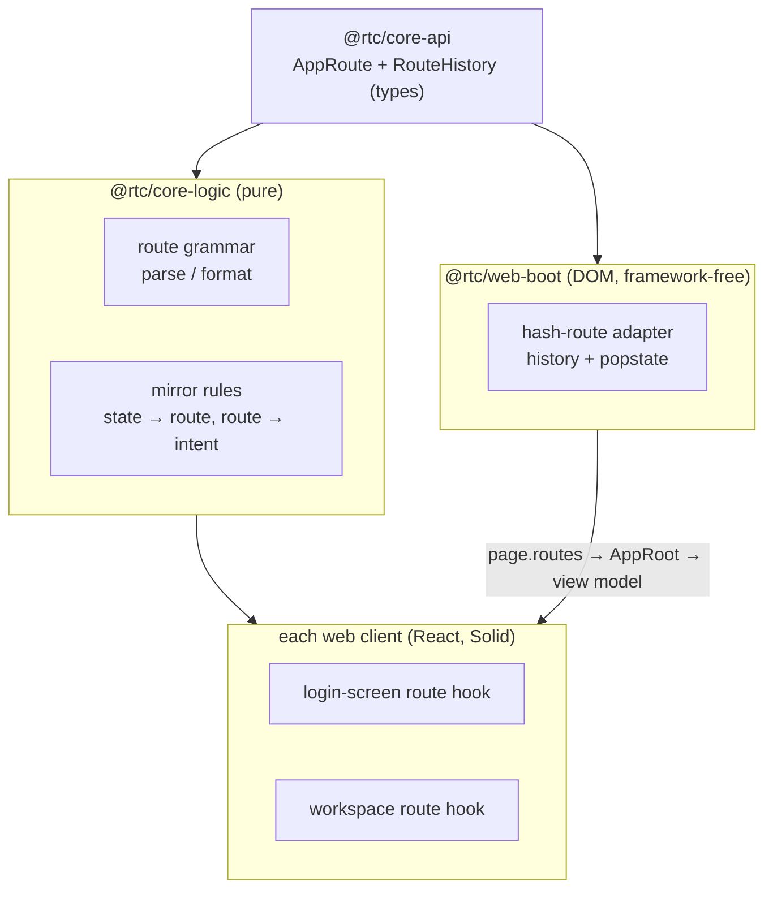
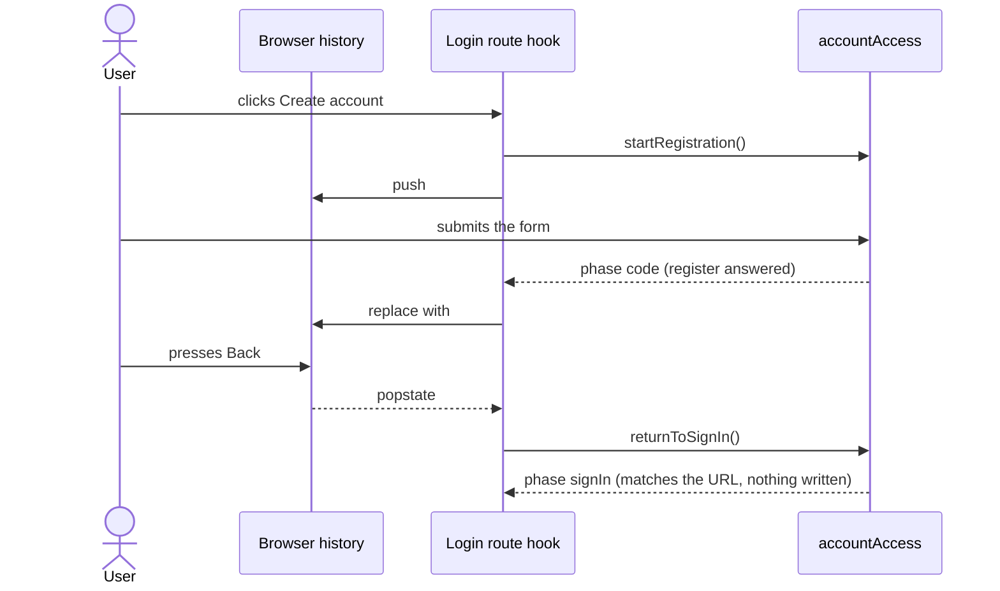

# Browser history and live field validation — design

**Date:** 2026-10-16
**Status:** approved in conversation, 2026-10-16
**Scope:** both web clients (`@rtc/client-react`, `@rtc/client-solid`). The React Native client and the three application cores do not change.

## 1. What the user asked for

Two observations on the B2b login screens:

1. *"When I'm on the login page, then navigate to either create account or password reset. If I change my mind and want to go back, my natural instinct is to press back in the browser, but when I do that, I'd navigate completely away from the app."*
2. *"When I enter email, password in the create account and reset password, it would be nice to have real time input validation (in addition to the server side validation on submit of course)."*

Decisions taken with the user before this spec:

- **Scope: login modes AND the workspace tabs.** One route scheme covers both; Back steps through tab switches too.
- **URL form: hash routes** (`…/#/create-account`). Real paths (`…/create-account`) are recorded in STATUS as a possible next step (§8).

## 2. Today

- The login modes are phases of the `accountAccess` machine (`signIn`, `register`, `code`, `requestReset`, and the three notices `pendingApproval`, `passwordUnset`, `passwordChanged`). The machine is created per login-screen mount (`useMachine(() => machines.accountAccess())`).
- The workspace tab is the app-wide `workspaceNav` machine, `{ activeTab }`, one intent `switchTab`. The header's tab bar and Jarvis's `switchTab` drive command both call it. Every core starts it on `"fx"`, so a reload, and a core swap from Preferences, both land on FX.
- The only history call in the app is `replaceState` stripping `?core=` (`@rtc/web-boot`'s `startWebClient`). Nothing pushes.
- The address, display name and code are checked only on submit (the fold's `checkEmailInput` / `checkDisplayNameInput` / `checkCodeInput`), and a refusal shows once, at form level (`login-error`). The new password already has its live checklist.

## 3. Routes

| route | hash | area |
|---|---|---|
| FX / Credit / Equities / Admin tab | `#/fx`, `#/credit`, `#/equities`, `#/admin` | workspace |
| Sign in | `#/sign-in` | account |
| Create account | `#/create-account` | account |
| Forgot password | `#/forgot-password` | account |
| Enter a code ("I already have a code") | `#/enter-code` | account |

Anything else in the hash (empty, unknown, malformed) reads as **no route**. The query string (`?core=`, `?splash`) and other paths (`/devtools/`) are untouched: a hash route never reads or writes them.

## 4. Architecture

The machines stay the source of truth for what is on screen. The URL mirrors them; a Back/Forward is turned into the matching intent, never into state written past the machine.

- **`@rtc/core-api` (types).** `AppRoute` (`{ area: "workspace"; tab }` or `{ area: "account"; mode }`, mode one of `signIn` / `register` / `requestReset` / `enterCode`) and the port `RouteHistory`: read the current route, push, replace, and subscribe to Back/Forward. A subscriber hears only history traversal, never its own push or replace.
- **`@rtc/core-logic` (pure).** The grammar (hash ⇄ `AppRoute`) and the mirror rules of §5 and §6 as functions of state and route. No DOM, so they are unit-tested and mutation-checked without a browser.
- **`@rtc/web-boot` (DOM).** One adapter implementing `RouteHistory` over `window.history` and `popstate`, created once per page by `startWebClient` and handed to the view exactly as the demo accounts are today (`page.routes` → `AppRoot` prop → the view model's shell options → a `useRouteHistory()` hook). A host that passes none (React Native, the contract harness unless a spec gives it a fake, the visual host) gets no routing: both hooks are no-ops.
- **Each web client.** Two thin hooks, one beside the login screen and one beside the workspace tab bar, that apply the rules. The forms and the tab bar do not change for routing, except that the login screen's four navigation links go through the hook (§6).

## 5. Workspace rules

- **Mount (signed in).** If the URL holds a workspace route, switch to its tab (`switchTab`); the URL wins. Otherwise (no route, or an account route left over from signing in) **replace** the URL with the current tab.
- **Tab changes after mount push.** A tab click and a Jarvis `switchTab` both change `workspaceNav`; when the new tab differs from the URL's, the hook **pushes** its route.
- **Back/Forward** to a workspace route → `switchTab(tab)`. The resulting state matches the URL, so nothing is pushed.
- **Back/Forward to an account route while signed in** → **replace** it with the current tab (a signed-in user never sees a login form by traversing history).
- **Core swap.** The swap remounts the view over the new core, whose nav starts on FX; the mount rule re-applies the URL's tab, so a swap keeps the tab. A reload keeps it the same way.
- **Admin.** `#/admin` behaves like any other tab today. Gating it by role is B2c's job.

## 6. Login rules

**The route each phase shows:**

| phase | route |
|---|---|
| `signIn` | `#/sign-in` — but a **workspace** route also counts as matching (§6, signed out on a tab URL) |
| `register` | `#/create-account` |
| `requestReset` | `#/forgot-password` |
| `code`, sign-up flow | `#/enter-code` |
| `code`, reset flow | `#/forgot-password` (there is no intent that opens a reset code step with nothing held) |
| `pendingApproval`, `passwordUnset`, `passwordChanged` | `#/sign-in` |

**Rules:**

- **The user's own navigation pushes.** The four links — Create account, Forgot password, I already have a code, Back to sign in — call their intent and **push** that mode's route.
- **Results replace.** When the phase changes for any other reason (a request answered: register → code, code → a notice, reset request → code) and the URL no longer matches the phase, the hook **replaces** the URL. Back from the code step therefore goes to wherever the user was before Create account, never to a create-account form whose request already finished.
- **Back/Forward** to an account route calls that mode's opening intent: `#/sign-in` → `returnToSignIn`, `#/create-account` → `startRegistration`, `#/forgot-password` → `startReset`, `#/enter-code` → `startCodeEntry`. Each opens the form fresh and supersedes a request in flight, exactly as the Back to sign in link does today. Back/Forward to a workspace route while signed out → `returnToSignIn` (the sign-in form, URL kept).
- **Mount (signed out).** An account route in the URL opens that mode (its opening intent). A workspace route is kept: the sign-in form shows and, once signed in, the workspace mount rule lands on that tab — so a shared `#/credit` link works, and signing out then back in returns to the same tab. No route → **replace** with `#/sign-in`.
- **Nothing secret reaches the URL or history state.** Routes carry a mode name only; the address, the password and the code never do. A reload on any login route opens the mode fresh (the held password lives only in the machine's closure, as today).

**A Back press during sign-up:**

## 7. Live field validation

- **Fields:** the email address (Create account, Forgot password, and the code step when it asks for an address), the display name (Create account) and the code (the code step). The new password keeps its checklist; the sign-in form is unchanged (its identifier may be a roster username, which is not an address).
- **The checks are the fold's own**: `checkEmailInput`, `checkDisplayNameInput`, `checkCodeInput` from `@rtc/core-logic`, with the copy they already return. The decision of what to show when is one pure helper in `@rtc/core-logic`; each client renders it.
- **When an error shows.** Nothing while the user first types into a field. Once the field has been left (blur) its error shows under it, and from then on it updates as the user types, so it disappears the moment the value is fixed. The field gets `aria-invalid` and `aria-describedby` pointing at its error.
- **Submit.** Every field's error becomes visible. If any field fails, focus moves to the first failing field in form order and nothing is sent, so a local refusal shows once, under its field, never also at form level. Otherwise the form submits as today.
- **Unchanged authority.** The fold still checks on submit (it is the guard for any caller that is not this form) and the server still checks. A server refusal still shows at form level (`login-error`).
- **Test ids.** The inline error is `login-field-error` with `data-field` naming the field (`email`, `display-name`, `code`).

## 8. Out of scope, recorded in STATUS

- **Real paths instead of hash routes** (`…/create-account`, `…/credit`). Needs an SPA rewrite on both Vercel projects (every unknown path → `index.html`), `/devtools/` excluded from it, and a client-side redirect from `#/…` to the path so links already shared keep working. The grammar and rules in `@rtc/core-logic` stay; only the adapter changes.
- **Gating `#/admin` by role** — B2c.

## 9. Testing

- **Pure rules** (`@rtc/core-logic`): the grammar round-trips every route and reads garbage as no route; every row of the §6 table and every rule of §5/§6 has a case; the field-feedback helper's show/hide states. Each rule is proven by a mutant (`scripts/mutation-check.mts`).
- **Adapter** (`@rtc/web-boot`, jsdom): push and replace write the hash and history entries; a subscriber hears `popstate`, not its own writes; the query string is preserved.
- **UI contract** (both clients, the shared `@rtc/ui-contract` specs with a fake `RouteHistory`): the link pushes, a result replaces, Back/Forward calls the intent, the signed-in/signed-out mount rules, tab push and Jarvis push; the inline errors on blur, live clearing, and the blocked submit that focuses the first failing field. Existing specs that submit an invalid address and expect `login-error` move to the inline error.
- **End to end** (both clients, real browser): Back and Forward through login modes, and through workspace tabs, including a reload that keeps the tab.
- **Visual**: one new scenario, the create-account form with inline errors showing, in the matrix for both clients; its goldens are accepted by eye.

## 10. Docs

- `docs/authentication.md` §7.9 (the login screen) gains the routes and the field-validation behaviour.
- `docs/STATUS.md`: remove the "Login screen: browser history and live input validation" entry; add the real-paths entry of §8.
